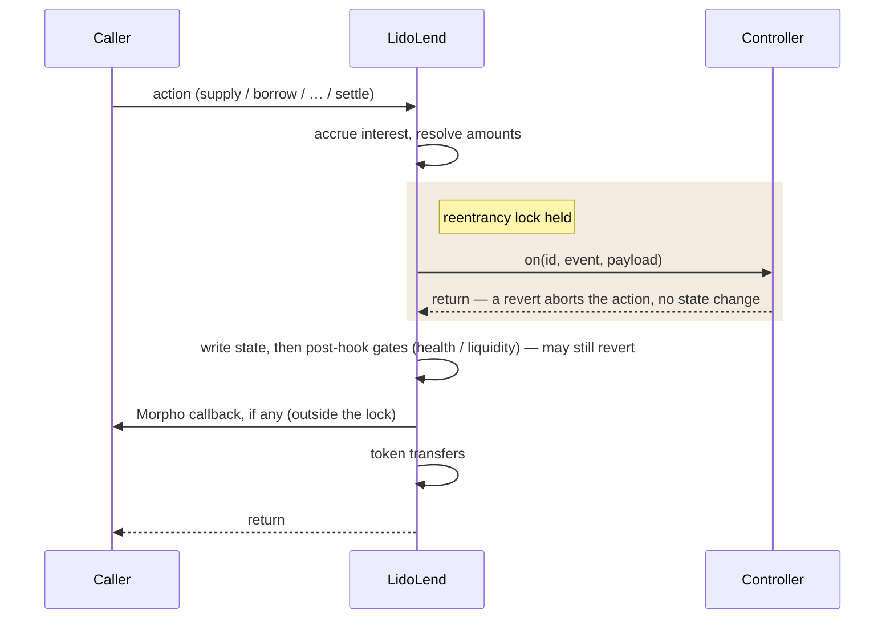

# LidoLend Specification

LidoLend is a Morpho Blue fork. It keeps the Morpho isolated-market accounting and adds two main features:

1. **Market controllers** — a market can be created with a controller contract bound to it. The core calls the controller before applying each market action, so custom policy can be enforced per action without touching user tokens.
2. **`settle`** — a settlement primitive that lets a lender exit by canceling borrower debt against its supply shares when ordinary liquidity is exhausted.

Two further changes:

3. **Owner-gated market creation** — upstream creation is permissionless, with IRMs and LLTVs enabled separately. Here a single owner-only `createMarket` fixes everything about a market in one step.
4. **Proxy deployment** — constructor setup becomes a one-shot initializer, and the EIP-712 domain separator is computed at call time.

## Inherited Behavior

Behavior not listed in this spec matches Morpho Blue at the pinned commit (`morpho-org/morpho-blue` @ `1478e9cfe1b4d514f80682b3b60e4e12ff3ee45a`, `src/Morpho.sol`). The whitepaper and upstream source are the normative reference for it. The rest of this section is a non-normative recap of the inherited model.

A market is identified by `Id = keccak256(MarketParams)`, where `MarketParams` is the loan token, collateral token, oracle, IRM (interest rate model), and LLTV (liquidation loan-to-value). Markets are isolated: positions and accounting are per-market, and collateral and debt are not shared across markets.

Lenders supply loan assets and hold supply shares. Borrowers post collateral and hold borrow shares. Share ↔ asset conversions use virtual balances, so empty markets divide safely and share-price inflation attacks are unprofitable. Separately, every conversion site picks its rounding direction (up or down) against the caller, so rounding always favors the protocol.

Interest accrues lazily, on `setFee` and every action that touches a market's positions or totals, except `supplyCollateral`. Anyone can also trigger an accrual directly with the external `accrueInterest`. Accrued interest is `totalBorrowAssets × wTaylorCompounded(borrowRate, elapsed)`, an approximation of continuous compounding. The same amount is added to both total borrow and total supply assets: borrowers owe it, lenders earn it. A market fee (owner-set, capped by `MAX_FEE`) is credited by minting supply shares to `feeRecipient`, diluting lenders instead of diverting assets. Markets with the zero-address IRM accrue nothing.

A position is liquidatable when its debt exceeds `LLTV × collateral value` at the oracle price. The liquidator's premium is the liquidation incentive factor `LIF`, bounded above and derived from the market's LLTV (see `ConstantsLib`), with no close factor. A liquidation that empties the collateral socializes the residual debt across lenders.

`onBehalf` actions require authorization (`setAuthorization` or an EIP-712 signature). Upstream, an authorized operator can borrow, withdraw, and withdraw collateral on behalf of the authorizer. This fork additionally lets it spend the authorizer's supply shares via `settle`.

`flashLoan` can lend any amount up to the contract's balance of a token — a balance that spans all markets — for one transaction, fee-free.

A market created with no controller behaves identically to upstream Morpho Blue for every inherited action. The only observable differences are owner-gated creation and the proxy-related changes.

## Market Creation

A Morpho market is defined entirely by its `MarketParams`: the loan token, the collateral token, the oracle, the IRM, and the LLTV. The market id is the hash of exactly those five fields (`keccak256(MarketParams)`). LidoLend gives each market two more values, a controller and a `settle` opt-in, but keeps them out of `MarketParams`, so the id and the way integrations derive it stay identical to Morpho.

Keeping the controller out of the id has a consequence. One set of `MarketParams` is still one market, so it can carry only one controller, bound when the market is created and never changed afterward. Choosing that controller is therefore a one-time decision, and that is why creation is restricted to the owner where upstream Morpho lets anyone create a market: the binding has to be the owner's call rather than a race to create first. The core can only check that a controller was built for the market it is bound to, not that its policy is sound, so the owner also vets the market's dependencies (see Trust Assumptions).

Because only the owner creates markets, the separate upstream step of enabling IRMs and LLTVs (`enableIrm` and `enableLltv`) is no longer needed and has been removed. Instead `createMarket` enables a market's IRM and LLTV on its own, still emitting the upstream `EnableIrm` and `EnableLltv` events. The `isIrmEnabled` and `isLltvEnabled` views still answer, but their meaning shifts: where upstream they were a pre-creation allowlist the owner curated, here they simply report whether some created market already uses that IRM or LLTV.

A market is created through one of two calls. `createMarket(params)` makes a plain market that has no controller and on which `settle` is unavailable. `createMarket(params, controller, enableSettlement)` makes a controlled market and rejects a zero controller (reverts `zero address`). Both bind their values permanently, with no setter to change them afterward:

- `marketController[id]` holds the controller. Its `marketId()` must match the id being created, or creation reverts with `controller mismatch`. Binding it emits `SetMarketController`.
- `isSettlementEnabled[id]` holds the `settle` opt-in. It can be set only in the controlled call, so settlement always comes with a controller. Enabling it emits `EnableSettlement`.

Everything else about creation is inherited. The market must not already exist, `IIrm.borrowRate` runs once so a stateful IRM can initialize, and the upstream `CreateMarket` event is emitted.

## Controller Hooks

The core is not responsible for policy — which actions are allowed, for whom, when, and at what size. That lives in the market's controller. To the core a controller is two functions: `marketId()`, the single market it is bound to, and `on(id, event, payload)`, the entrypoint the core calls before each action. The core never reads controller state, so this is the only coupling.

Before applying an action the core calls `on` with one ABI-encoded struct per event (`SupplyHookData`, `BorrowHookData`, and so on, defined in `ILidoLendMarketController.sol`). A revert from the controller aborts the action with no state change. That revert is the controller's only hold on the action it is hooking, and it cannot rewrite the resolved amounts or partially allow the action. It is not a lock on the whole core, as the two properties below make precise.



The tail of the diagram is schematic. The exact order of token transfers and the Morpho callback is per-action and unchanged from upstream — `liquidate`, for one, sends the seized collateral before its callback and pulls the loan repayment after.

Two properties keep this safe. The hook fires after interest accrual and after the amounts are fully resolved, but before any state change or transfer, so the controller sees final numbers it cannot then alter. And a transient lock is held for the length of `on`, so while a hook runs any hooked action on a controlled market reverts with `hook reentrancy`. The lock lives in the dispatch, so a market with no controller is never gated, and `flashLoan` and the authorization calls stay reachable from inside a hook because they touch no market accounting.

A few actions deviate from that timing:

- `supplyCollateral` accrues no interest (collateral does not affect it), so its hook sees a stale interest state.
- External `accrueInterest` fires the hook before accruing, since there is nothing to resolve.
- Fee shares minted to `feeRecipient` during accrual fire no hook, and the owner's `setFee` accrues interest (so it may mint those shares) with no hook at all. A controller that mirrors supply totals must account for that drift.
- `flashLoan` has no hook at all, so any settle-relevant policy has to live on the hooks of the actions an attacker would eventually call.

The `HookEvent` enum and the payload structs are defined in `ILidoLendMarketController.sol`, and their order and layout are append-only: the controller decodes each payload by event, so reordering or reshaping would silently misroute every deployed controller.

The hook is not the last gate. The inherited post-mutation checks (withdraw and borrow liquidity, borrow and withdraw-collateral health) still run after it, and a revert there rolls back the controller too. The obligation also runs the other way: policy must respect the flows its market serves, since a controller that vetoes `withdraw` for a vault bricks that vault's reallocation.

## Settlement

`settle` lets a lender exit through a borrower's position when ordinary liquidity is exhausted: the lender burns supply shares (given as either a loan-asset amount `supplyAssets` or a share amount `supplyShares`, exactly one non-zero, like `withdraw`), canceling an equal value of borrower debt, and the borrower's collateral moves to the receiver at the oracle price — no liquidation incentive (`LIF = 1`).

The core derives the amounts in order, every rounding either against the exiting lender or in the protocol's favor (as in `withdraw`):

| Quantity | Computed as | Rounds |
| --- | --- | --- |
| the input left at zero | `supplyAssets.toSharesUp` (asset input) or `supplyShares.toAssetsDown` (share input), over the supply totals | against the lender |
| `debtCanceled` | `supplyAssets`, the loan-asset value of the burned supply | — |
| `collateralSeized` | `debtCanceled × ORACLE_PRICE_SCALE / oraclePrice` | down, in the borrower's favor |
| `borrowSharesToBurn` | `debtCanceled.toSharesUp`, over the borrow totals | up, in the protocol's favor |

`oraclePrice` is the market oracle's `price()` per upstream `IOracle` — collateral quoted in loan token, scaled by `ORACLE_PRICE_SCALE = 1e36` with token decimals folded in, and it is the same price that feeds health checks and liquidation. The market's total supply and borrow assets are then reduced by `debtCanceled` with a zero floor.

Net effect of a settle of `X` in loan value at oracle price `P`. No loan tokens move. The lender's claim and the borrower's debt cancel at par, and the borrower's collateral pays the receiver:

| Balance | Change |
| --- | --- |
| `onBehalf` supply shares | burned, worth `X` |
| `totalSupplyAssets` | − `X` (zero-floored) |
| `borrower` borrow shares | burned, worth `X` |
| `totalBorrowAssets` | − `X` (zero-floored) |
| `borrower` collateral | − `X / P` |
| `receiver` | + `X / P` collateral |

The routine guards are listed with the function in the reference: the market exists and has settlement enabled, exactly one amount is non-zero, the caller is authorized for `onBehalf`, the borrower has debt, and the cut fits within the borrower's collateral and debt. One gate is specific to settle. After accrual, `debtCanceled` must strictly exceed `totalSupplyAssets − totalBorrowAssets`, the value an ordinary withdraw could serve. That bound is an accounting quantity rather than a token balance, so flash loans and donations cannot open it. One precondition carries no dedicated revert string: `onBehalf` must own at least the supply shares being burned, exactly as in `withdraw`, or the share subtraction underflows into a plain arithmetic panic.

Illustrative numbers: at an oracle price of `3e36` (one collateral unit is worth three loan units), a lender burns shares worth `debtCanceled = 100` loan units (the share conversion already rounded this down). Collateral seized: `100 × 1e36 / 3e36 = 33` — the fractional `.33` stays with the borrower. Borrow shares burned: shares worth `100`, rounded up, so the borrower's debt falls by at least `100` — the rounding dust favors the protocol.

The core performs **no health check on the borrower**. `settle` is soft liquidation and must reach unhealthy-but-solvent positions (`LLTV < LTV < 100%`) — a health gate would block exactly the positions it exists for. Two consequences: absent controller policy, even a healthy borrower can be cut — borrower selection and cut sizing are entirely the controller's responsibility — and bad-debt positions (`LTV > 100%`) must be excluded by the controller, not the core.

A cut removes equal value `X` from both sides, so LTV `D/C` moves to `(D−X)/(C−X)` — down for a solvent borrower, up for an insolvent one:

| Borrower | LTV before | cut `X` | LTV after |
| --- | --- | --- | --- |
| solvent (`D < C`) | 80 / 100 = 0.80 | 40 | 40 / 60 = 0.67 ↓ |
| insolvent (`D > C`) | 120 / 100 = 1.20 | 50 | 70 / 50 = 1.40 ↑ |

So a cut heals a solvent position (par, no penalty — milder than liquidation, and the borrower's only cost is the forced shrinkage of a position it chose to hold), but a cut on a bad-debt position concentrates the shortfall on the remaining collateral. Excluding `LTV > 100%` borrowers is therefore a load-bearing controller duty, not a convention.

`settle` never realizes bad debt: unlike `liquidate`, a cut that empties the collateral leaves residual borrow shares in place, to be socialized only by a subsequent liquidation. Liquidation remains the path for ordinary unhealthy positions, and settlement does not replace it.

## Proxy And Storage

LidoLend runs behind `OssifiableProxy`. Two upstream constructs are reshaped for delegatecall:

- The constructor-based owner setup becomes `initialize(address newOwner)`: one-shot (reverts `already initialized` on repeat), sets a non-zero owner (`zero address` otherwise), emits `SetOwner`. The implementation's constructor sets `isInitialized = true`, so the bare implementation is permanently uninitializable and unownable. Only proxies, which start at `false`, can initialize.
- `DOMAIN_SEPARATOR` is a view function recomputing `keccak256(DOMAIN_TYPEHASH, chainid, address(this))` per call. EIP-712 authorization signatures therefore bind to the proxy address (invalid against the implementation's domain, and vice versa). Tracking the live `block.chainid` also means that after a chain split the separator follows the post-split id, invalidating pre-split signatures on the chain whose id changes — the inverse of upstream's bake-once replay warning.

Storage layout is append-only — under a proxy this is load-bearing:

| Slots | Variables | Origin |
| --- | --- | --- |
| 0–8 | `owner`, `feeRecipient`, `position`, `market`, `isIrmEnabled`, `isLltvEnabled`, `isAuthorized`, `nonce`, `idToMarketParams` | upstream, unchanged order |
| 9 | `marketController` | fork |
| 10 | `isSettlementEnabled` | fork |
| 11 | `isInitialized` | fork |

The layout is a single linear sequence from slot 0, and `OssifiableProxy` keeps its own implementation and admin pointers in EIP-1967 slots that do not collide with it, so the proxy never writes any of slots 0–11. New fields must be appended after `isInitialized`, never inserted. The hook-reentrancy lock is transient storage and occupies no slot. Transient storage (EIP-1153) requires the Cancun EVM and Solidity 0.8.30 — the fork's deployment floor, above upstream's 0.8.19, so target chains must support it. Fork-added revert strings and events are appended in place to the upstream `ErrorsLib` and `EventsLib` under `FORK-ADDED` sections.

## Trust Assumptions

This section states what each actor can do to this contract. Governance design — who holds each role and through what process it acts — is outside this core spec.

**Proxy admin** can replace the implementation — total power over state and funds. This is the largest departure from upstream, whose contract is immutable and whose governance cannot manage funds. The trade is deliberate, and constraints on the admin (timelocks, governance) are an operational matter outside this spec.

**Owner** creates markets, sets the fee (capped by `MAX_FEE`) and the fee recipient, and transfers ownership. It cannot seize principal or touch positions directly. The fee is the one lever that moves value: within `MAX_FEE`, each interest accrual mints supply shares to the fee recipient, who can then withdraw them, so the owner can divert a bounded slice of interest but never the deposited principal. Vetting each market's dependencies against the list below is the owner's duty, since creation is owner-gated.

**Controller** is trusted by construction. It can veto every hooked action — a broken or malicious controller freezes its market, and since the binding is immutable, recovery requires upgrading the core or the controller itself. Hooks give it no handles on funds or accounting: it is called, holds no approvals, and owns no core state — though it may keep its own state (e.g. a borrower-eligibility queue or per-user watermarks), update it inside the hook (`on` is not `view`), and expose it for reads. The core neither writes nor depends on it. The reentrancy window the hook call opens is closed mechanically by the transient lock (see Controller Hooks). Inherited user callbacks fire after state mutations, outside the lock, and keep the upstream semantics.

**Oracle and IRM** carry the upstream trust: the oracle prices collateral for health, liquidation, and `settle` alike (settlement adds no new oracle power — same price, no incentive), and the IRM prices time.

**Tokens and dependencies** must satisfy the upstream assumption list (`IMorphoBase.createMarket` NatSpec). Tokens are ERC-20 compliant (return values may be omitted) and change balances only by the exact transferred amount — no transfer fees, no burns, and **no rebasing** (stETH does not qualify, wstETH does). Neither token, IRM, nor oracle re-enters the core. Supplied and borrowed amounts stay below ~1e32, and the oracle is correctly scaled and cannot instantly drop by more than `LLTV × LIF`.

**Callback callers** (`supply`, `repay`, `supplyCollateral`, `liquidate`, `flashLoan` with `data`) keep the inherited reentrancy surface. A callback that re-enters the core runs the nested action through hooks.

## Fork Delta

The per-function API reference lives in API Reference below, generated from natspec. This section is only the list of intentional changes from upstream `1478e9cf`.

- **New functions:** `settle`, `initialize`, the three-argument `createMarket`, and the `marketController` / `isSettlementEnabled` / `isInitialized` getters.
- **Owner-gated creation:** both `createMarket` overloads are `onlyOwner`. `enableIrm` / `enableLltv` are removed, and creation enables the IRM and LLTV itself.
- **Controller hooks:** the nine state-changing actions dispatch the bound controller before mutating state, under a transient reentrancy lock.
- **Proxy:** `DOMAIN_SEPARATOR` is recomputed per call, and constructor petrification plus `initialize` replace the upstream constructor.
- **Storage:** `marketController`, `isSettlementEnabled`, and `isInitialized` are appended at slots 9–11.
- **Errors and events:** the fork-added ones live in the `FORK-ADDED` sections of `ErrorsLib` and `EventsLib`.

Every other inherited function body is unchanged from upstream — the rest of the source diff is the contract rename, import paths, and comments.

## References

- Morpho Blue source at the pinned commit and [`morpho-blue-whitepaper.pdf`](./morpho-blue-whitepaper.pdf) — normative for inherited behavior.
- `FORK_NOTES.md` — canonical record of the fork point and delta.
- `src/interfaces/ILidoLendMarketController.sol` — normative hook ABI.
- `src/interfaces/ILidoLend.sol` — typed core surface for consumers.
- API Reference below — the contract reference, generated from the solc AST by `make doc`.
- Each market controller's own documentation — the policy it enforces through the hooks.

## API Reference

<!-- BEGIN AUTOGENERATED API: generated from solc artifacts — do not edit by hand, regenerate with `make doc` -->

### Types

#### `Id`

```solidity
type Id is bytes32
```

A market identifier, the `keccak256` hash of a `MarketParams`.

#### `MarketParams`

```solidity
struct MarketParams {
    address loanToken;
    address collateralToken;
    address oracle;
    address irm;
    uint256 lltv;
}
```

The immutable parameters that define a market and, hashed, its `Id`.

**Fields**

| Name | Type | Description |
| --- | --- | --- |
| `loanToken` | `address` | The token lenders supply and borrowers borrow. |
| `collateralToken` | `address` | The token borrowers post as collateral. |
| `oracle` | `address` | Prices the collateral in loan-token terms. |
| `irm` | `address` | The interest rate model. |
| `lltv` | `uint256` | The liquidation loan-to-value, in WAD. |

#### `Position`

```solidity
struct Position {
    uint256 supplyShares;
    uint128 borrowShares;
    uint128 collateral;
}
```

A single account's position in one market.

> [!WARNING]
> For `feeRecipient`, `supplyShares` does not contain the accrued shares since the last interest accrual.

**Fields**

| Name | Type | Description |
| --- | --- | --- |
| `supplyShares` | `uint256` | The account's supply shares. |
| `borrowShares` | `uint128` | The account's borrow shares. |
| `collateral` | `uint128` | The account's collateral, in collateral-token units. |

#### `Market`

```solidity
struct Market {
    uint128 totalSupplyAssets;
    uint128 totalSupplyShares;
    uint128 totalBorrowAssets;
    uint128 totalBorrowShares;
    uint128 lastUpdate;
    uint128 fee;
}
```

A market's aggregate accounting state.

> [!WARNING]
> `totalSupplyAssets` does not contain the accrued interest since the last interest accrual.

> [!WARNING]
> `totalBorrowAssets` does not contain the accrued interest since the last interest accrual.

> [!WARNING]
> `totalSupplyShares` does not contain the additional shares accrued by `feeRecipient` since the last interest accrual.

**Fields**

| Name | Type | Description |
| --- | --- | --- |
| `totalSupplyAssets` | `uint128` | The total loan assets supplied to the market. |
| `totalSupplyShares` | `uint128` | The total supply shares outstanding. |
| `totalBorrowAssets` | `uint128` | The total loan assets borrowed from the market. |
| `totalBorrowShares` | `uint128` | The total borrow shares outstanding. |
| `lastUpdate` | `uint128` | The timestamp of the last interest accrual. |
| `fee` | `uint128` | The market fee, in WAD, capped by `MAX_FEE`. |

#### `Authorization`

```solidity
struct Authorization {
    address authorizer;
    address authorized;
    bool isAuthorized;
    uint256 nonce;
    uint256 deadline;
}
```

An EIP-712 authorization message for `setAuthorizationWithSig`.

**Fields**

| Name | Type | Description |
| --- | --- | --- |
| `authorizer` | `address` | The account granting or revoking the authorization. |
| `authorized` | `address` | The account being authorized. |
| `isAuthorized` | `bool` | Whether `authorized` becomes authorized for `authorizer`. |
| `nonce` | `uint256` | The authorizer's current nonce, which blocks replay. |
| `deadline` | `uint256` | The latest timestamp at which the signature is valid. |

#### `Signature`

```solidity
struct Signature {
    uint8 v;
    bytes32 r;
    bytes32 s;
}
```

The `v`, `r`, and `s` components of an ECDSA signature.

**Fields**

| Name | Type | Description |
| --- | --- | --- |
| `v` | `uint8` | The recovery identifier. |
| `r` | `bytes32` | The `r` component. |
| `s` | `bytes32` | The `s` component. |

### `LidoLend`

Morpho Blue fork core with optional per-market controllers.

`Position`, `Market`, `MarketParams`, and market id derivation stay upstream-shaped. Optional per-market controllers can enforce additional policy through action hooks. The `settle` extension is enabled per market at creation, and only on a market that has a controller, so the controller's policy can govern who may be settled and by how much.

#### Functions

##### `constructor`

```solidity
constructor();
```

Petrifies the implementation, so only a proxy can call `initialize`.

##### `DOMAIN_SEPARATOR`

```solidity
function DOMAIN_SEPARATOR() public view returns (bytes32);
```

The EIP-712 domain separator.

> [!WARNING]
> Every EIP-712 signed message based on this domain separator can be reused on chains sharing the same chain id and on forks because the domain separator would be the same.

> [!WARNING]
> Unlike upstream Morpho, the separator is not baked into bytecode at construction: it is recomputed from the live `block.chainid` and `address(this)` on every call, so under the proxy it binds to the proxy address, and after a chain split it tracks the post-split chain id (pre-split signatures become invalid on the chain that changes id, instead of staying replayable as the warning above describes).

##### `initialize`

```solidity
function initialize(address newOwner) external;
```

**Parameters**

| Name | Type | Description |
| --- | --- | --- |
| `newOwner` | `address` | The new owner of the contract. |

One-shot initializer setting `newOwner` as `owner`. Called by the proxy at deploy time.

Fork-added for the upgradeable-proxy deployment: the implementation is petrified by its constructor, so only a proxy's storage can be initialized, and only once.

##### `setOwner`

```solidity
function setOwner(address newOwner) external;
```

Sets `newOwner` as `owner` of the contract.

> [!WARNING]
> No two-step transfer ownership.

> [!WARNING]
> The owner can be set to the zero address.

##### `setFee`

```solidity
function setFee(MarketParams memory marketParams, uint256 newFee) external;
```

**Parameters**

| Name | Type | Description |
| --- | --- | --- |
| `marketParams` | `MarketParams` |  |
| `newFee` | `uint256` | The new fee, scaled by WAD. |

Sets the `newFee` for the given market `marketParams`.

> [!WARNING]
> The recipient can be the zero address.

##### `setFeeRecipient`

```solidity
function setFeeRecipient(address newFeeRecipient) external;
```

Sets `newFeeRecipient` as `feeRecipient` of the fee.

> [!WARNING]
> If the fee recipient is set to the zero address, fees will accrue there and will be lost.

Modifying the fee recipient will allow the new recipient to claim any pending fees not yet accrued. To ensure that the current recipient receives all due fees, accrue interest manually prior to making any changes.

##### `createMarket`

```solidity
function createMarket(MarketParams memory marketParams) external;
```

Creates the market `marketParams`.

Here is the list of assumptions on the market's dependencies (tokens, IRM and oracle) that guarantees Morpho behaves as expected:

- The token should be ERC-20 compliant, except that it can omit return values on `transfer` and `transferFrom`.
- The token balance of Morpho should only decrease on `transfer` and `transferFrom`. In particular, tokens with burn functions are not supported.
- The token should not re-enter Morpho on `transfer` nor `transferFrom`.
- The token balance of the sender (resp. receiver) should decrease (resp. increase) by exactly the given amount on `transfer` and `transferFrom`. In particular, tokens with fees on transfer are not supported.
- The IRM should not re-enter Morpho.
- The oracle should return a price with the correct scaling.
- The oracle price should not be able to change instantly such that the new price is less than the old price multiplied by LLTV*LIF. In particular, if the loan asset is a vault that can receive donations, the oracle should not price its shares using the AUM.

Here is a list of assumptions on the market's dependencies which, if broken, could break Morpho's liveness properties (funds could get stuck):

- The token should not revert on `transfer` and `transferFrom` if balances and approvals are right.
- The amount of assets supplied and borrowed should not be too high (max ~1e32), otherwise the number of shares might not fit within 128 bits.
- The IRM should not revert on `borrowRate`.
- The IRM should not return a very high borrow rate (otherwise the computation of `interest` in `_accrueInterest` can overflow).
- The oracle should not revert `price`.
- The oracle should not return a very high price (otherwise the computation of `maxBorrow` in `_isHealthy` or of `assetsRepaid` in `liquidate` can overflow).

The borrow share price of a market with less than 1e4 assets borrowed can be decreased by manipulations, to the point where `totalBorrowShares` is very large and borrowing overflows.

> [!WARNING]
> `createMarket` is `onlyOwner` in this fork, whereas upstream Morpho market creation is permissionless. Creating a market marks its `irm` and `lltv` as enabled on first use, emitting `EnableIrm`/`EnableLltv` (the standalone `enableIrm`/`enableLltv` are removed in this fork). This function creates a plain market with no controller. The three-argument overload in `ILidoLend` creates a controlled one.

##### `createMarket`

```solidity
function createMarket(
    MarketParams memory marketParams,
    address controller,
    bool enableSettlement
) external;
```

**Parameters**

| Name | Type | Description |
| --- | --- | --- |
| `marketParams` | `MarketParams` | The market to create. |
| `controller` | `address` | The controller to bind. Must be non-zero and built for this market. |
| `enableSettlement` | `bool` | Whether `settle` is enabled for this market. |

Creates the market `marketParams` as a controlled market, binding `controller` and the `settle` opt-in.

Fork-added overload. Like the single-argument `createMarket` it is `onlyOwner`, and that single-argument call is the only way to create a market without a controller. The controller and `settle` opt-in cannot be changed after creation.

##### `_createMarket`

```solidity
function _createMarket(
    MarketParams memory marketParams,
    address controller,
    bool enableSettlement
) internal;
```

Implements both `createMarket` overloads. The `controller` and settlement opt-in cannot be changed after creation. Marks the market's `irm` and `lltv` as enabled on first use: the standalone `enableIrm`/`enableLltv` are removed in this fork since `createMarket` is `onlyOwner`.

##### `supply`

```solidity
function supply(
    MarketParams memory marketParams,
    uint256 assets,
    uint256 shares,
    address onBehalf,
    bytes calldata data
) external returns (uint256, uint256);
```

**Parameters**

| Name | Type | Description |
| --- | --- | --- |
| `marketParams` | `MarketParams` | The market to supply assets to. |
| `assets` | `uint256` | The amount of assets to supply. |
| `shares` | `uint256` | The amount of shares to mint. |
| `onBehalf` | `address` | The address that will own the increased supply position. |
| `data` | `bytes` | Arbitrary data to pass to the `onMorphoSupply` callback. Pass empty data if not needed. |

**Returns**

| Name | Type | Description |
| --- | --- | --- |
| `<none>` | `uint256` | assetsSupplied The amount of assets supplied. |
| `<none>` | `uint256` | sharesSupplied The amount of shares minted. |

Supplies `assets` or `shares` on behalf of `onBehalf`, optionally calling back the caller's `onMorphoSupply` function with the given `data`.

Either `assets` or `shares` should be zero. Most use cases should rely on `assets` as an input so the caller is guaranteed to have `assets` tokens pulled from their balance, but the possibility to mint a specific amount of shares is given for full compatibility and precision.

Supplying a large amount can revert for overflow.

Supplying an amount of shares may lead to supply more or fewer assets than expected due to slippage. Consider using the `assets` parameter to avoid this.

> [!WARNING]
> On a market with a controller, this function calls the controller's `Supply` hook after interest accrual and before applying the state changes, and reverts when reentered from a controller hook. The hook itself may revert.

##### `withdraw`

```solidity
function withdraw(
    MarketParams memory marketParams,
    uint256 assets,
    uint256 shares,
    address onBehalf,
    address receiver
) external returns (uint256, uint256);
```

**Parameters**

| Name | Type | Description |
| --- | --- | --- |
| `marketParams` | `MarketParams` | The market to withdraw assets from. |
| `assets` | `uint256` | The amount of assets to withdraw. |
| `shares` | `uint256` | The amount of shares to burn. |
| `onBehalf` | `address` | The address of the owner of the supply position. |
| `receiver` | `address` | The address that will receive the withdrawn assets. |

**Returns**

| Name | Type | Description |
| --- | --- | --- |
| `<none>` | `uint256` | assetsWithdrawn The amount of assets withdrawn. |
| `<none>` | `uint256` | sharesWithdrawn The amount of shares burned. |

Withdraws `assets` or `shares` on behalf of `onBehalf` and sends the assets to `receiver`.

Either `assets` or `shares` should be zero. To withdraw max, pass the `shares`'s balance of `onBehalf`.

`msg.sender` must be authorized to manage `onBehalf`'s positions.

Withdrawing an amount corresponding to more shares than supplied will revert for underflow.

It is advised to use the `shares` input when withdrawing the full position to avoid reverts due to conversion roundings between shares and assets.

> [!WARNING]
> On a market with a controller, this function calls the controller's `Withdraw` hook after interest accrual and before applying the state changes, and reverts when reentered from a controller hook. The hook itself may revert.

##### `borrow`

```solidity
function borrow(
    MarketParams memory marketParams,
    uint256 assets,
    uint256 shares,
    address onBehalf,
    address receiver
) external returns (uint256, uint256);
```

**Parameters**

| Name | Type | Description |
| --- | --- | --- |
| `marketParams` | `MarketParams` | The market to borrow assets from. |
| `assets` | `uint256` | The amount of assets to borrow. |
| `shares` | `uint256` | The amount of shares to mint. |
| `onBehalf` | `address` | The address that will own the increased borrow position. |
| `receiver` | `address` | The address that will receive the borrowed assets. |

**Returns**

| Name | Type | Description |
| --- | --- | --- |
| `<none>` | `uint256` | assetsBorrowed The amount of assets borrowed. |
| `<none>` | `uint256` | sharesBorrowed The amount of shares minted. |

Borrows `assets` or `shares` on behalf of `onBehalf` and sends the assets to `receiver`.

Either `assets` or `shares` should be zero. Most use cases should rely on `assets` as an input so the caller is guaranteed to borrow `assets` of tokens, but the possibility to mint a specific amount of shares is given for full compatibility and precision.

`msg.sender` must be authorized to manage `onBehalf`'s positions.

Borrowing a large amount can revert for overflow.

Borrowing an amount of shares may lead to borrow fewer assets than expected due to slippage. Consider using the `assets` parameter to avoid this.

> [!WARNING]
> On a market with a controller, this function calls the controller's `Borrow` hook after interest accrual and before applying the state changes, and reverts when reentered from a controller hook. The hook itself may revert.

##### `repay`

```solidity
function repay(
    MarketParams memory marketParams,
    uint256 assets,
    uint256 shares,
    address onBehalf,
    bytes calldata data
) external returns (uint256, uint256);
```

**Parameters**

| Name | Type | Description |
| --- | --- | --- |
| `marketParams` | `MarketParams` | The market to repay assets to. |
| `assets` | `uint256` | The amount of assets to repay. |
| `shares` | `uint256` | The amount of shares to burn. |
| `onBehalf` | `address` | The address of the owner of the debt position. |
| `data` | `bytes` | Arbitrary data to pass to the `onMorphoRepay` callback. Pass empty data if not needed. |

**Returns**

| Name | Type | Description |
| --- | --- | --- |
| `<none>` | `uint256` | assetsRepaid The amount of assets repaid. |
| `<none>` | `uint256` | sharesRepaid The amount of shares burned. |

Repays `assets` or `shares` on behalf of `onBehalf`, optionally calling back the caller's `onMorphoRepay` function with the given `data`.

Either `assets` or `shares` should be zero. To repay max, pass the `shares`'s balance of `onBehalf`.

Repaying an amount corresponding to more shares than borrowed will revert for underflow.

It is advised to use the `shares` input when repaying the full position to avoid reverts due to conversion roundings between shares and assets.

An attacker can front-run a repay with a small repay making the transaction revert for underflow.

> [!WARNING]
> On a market with a controller, this function calls the controller's `Repay` hook after interest accrual and before applying the state changes, and reverts when reentered from a controller hook. The hook itself may revert.

##### `supplyCollateral`

```solidity
function supplyCollateral(
    MarketParams memory marketParams,
    uint256 assets,
    address onBehalf,
    bytes calldata data
) external;
```

**Parameters**

| Name | Type | Description |
| --- | --- | --- |
| `marketParams` | `MarketParams` | The market to supply collateral to. |
| `assets` | `uint256` | The amount of collateral to supply. |
| `onBehalf` | `address` | The address that will own the increased collateral position. |
| `data` | `bytes` | Arbitrary data to pass to the `onMorphoSupplyCollateral` callback. Pass empty data if not needed. |

Supplies `assets` of collateral on behalf of `onBehalf`, optionally calling back the caller's `onMorphoSupplyCollateral` function with the given `data`.

Interest is not accrued since it's not required and it saves gas.

Supplying a large amount can revert for overflow.

> [!WARNING]
> On a market with a controller, this function calls the controller's `SupplyCollateral` hook before applying the state changes (no interest is accrued), and reverts when reentered from a controller hook. The hook itself may revert.

##### `withdrawCollateral`

```solidity
function withdrawCollateral(
    MarketParams memory marketParams,
    uint256 assets,
    address onBehalf,
    address receiver
) external;
```

**Parameters**

| Name | Type | Description |
| --- | --- | --- |
| `marketParams` | `MarketParams` | The market to withdraw collateral from. |
| `assets` | `uint256` | The amount of collateral to withdraw. |
| `onBehalf` | `address` | The address of the owner of the collateral position. |
| `receiver` | `address` | The address that will receive the collateral assets. |

Withdraws `assets` of collateral on behalf of `onBehalf` and sends the assets to `receiver`.

`msg.sender` must be authorized to manage `onBehalf`'s positions.

Withdrawing an amount corresponding to more collateral than supplied will revert for underflow.

> [!WARNING]
> On a market with a controller, this function calls the controller's `WithdrawCollateral` hook after interest accrual and before applying the state changes, and reverts when reentered from a controller hook. The hook itself may revert.

##### `settle`

```solidity
function settle(
    MarketParams memory marketParams,
    uint256 supplyAssets,
    uint256 supplyShares,
    address onBehalf,
    address borrower,
    address receiver
) external returns (uint256 collateralSeized, uint256 debtCanceled);
```

**Parameters**

| Name | Type | Description |
| --- | --- | --- |
| `marketParams` | `MarketParams` | The market to settle on. |
| `supplyAssets` | `uint256` | The loan-asset value of `onBehalf`'s supply position to settle (and debt to cancel). |
| `supplyShares` | `uint256` | The amount of supply shares to burn from `onBehalf`. |
| `onBehalf` | `address` | The address whose supply shares are burned. |
| `borrower` | `address` | The borrower whose debt is canceled and collateral seized. |
| `receiver` | `address` | The address that receives the seized collateral. |

**Returns**

| Name | Type | Description |
| --- | --- | --- |
| `collateralSeized` | `uint256` | The collateral-token amount seized and sent to `receiver`. |
| `debtCanceled` | `uint256` | The loan-token amount of `borrower` debt canceled (equals the settled supply value at par, not a `borrowShares` count). |

Cancels `borrower`'s debt against `onBehalf`'s supply shares, seizing collateral to `receiver`.

Fork-added single-borrower primitive, enabled per market at creation. One of `supplyAssets` or `supplyShares` must be zero, and the loan-asset value of the burned supply position is the borrower debt canceled. Callable only by `onBehalf` or an address authorized by `onBehalf`, and only when ordinary withdraw liquidity is insufficient to cover the canceled debt. The bound controller's `Settle` hook enforces borrower eligibility and the per-cut slice cap, and may revert. Reverts while another action's controller hook is executing.

##### `liquidate`

```solidity
function liquidate(
    MarketParams memory marketParams,
    address borrower,
    uint256 seizedAssets,
    uint256 repaidShares,
    bytes calldata data
) external returns (uint256, uint256);
```

**Parameters**

| Name | Type | Description |
| --- | --- | --- |
| `marketParams` | `MarketParams` | The market of the position. |
| `borrower` | `address` | The owner of the position. |
| `seizedAssets` | `uint256` | The amount of collateral to seize. |
| `repaidShares` | `uint256` | The amount of shares to repay. |
| `data` | `bytes` | Arbitrary data to pass to the `onMorphoLiquidate` callback. Pass empty data if not needed. |

**Returns**

| Name | Type | Description |
| --- | --- | --- |
| `<none>` | `uint256` | The amount of assets seized. |
| `<none>` | `uint256` | The amount of assets repaid. |

Liquidates the given `repaidShares` of debt asset or seize the given `seizedAssets` of collateral on the given market `marketParams` of the given `borrower`'s position, optionally calling back the caller's `onMorphoLiquidate` function with the given `data`.

Either `seizedAssets` or `repaidShares` should be zero.

Seizing more than the collateral balance will underflow and revert without any error message.

Repaying more than the borrow balance will underflow and revert without any error message.

An attacker can front-run a liquidation with a small repay making the transaction revert for underflow.

> [!WARNING]
> On a market with a controller, this function calls the controller's `Liquidate` hook after interest accrual and before applying the state changes, and reverts when reentered from a controller hook. The hook itself may revert.

##### `flashLoan`

```solidity
function flashLoan(address token, uint256 assets, bytes calldata data) external;
```

**Parameters**

| Name | Type | Description |
| --- | --- | --- |
| `token` | `address` | The token to flash loan. |
| `assets` | `uint256` | The amount of assets to flash loan. |
| `data` | `bytes` | Arbitrary data to pass to the `onMorphoFlashLoan` callback. |

Executes a flash loan.

Flash loans have access to the whole balance of the contract (the liquidity and deposited collateral of all markets combined, plus donations).

> [!WARNING]
> Not ERC-3156 compliant but compatibility is easily reached:

- `flashFee` is zero.
- `maxFlashLoan` is the token's balance of this contract.
- The receiver of `assets` is the caller.

##### `setAuthorization`

```solidity
function setAuthorization(address authorized, bool newIsAuthorized) external;
```

**Parameters**

| Name | Type | Description |
| --- | --- | --- |
| `authorized` | `address` | The authorized address. |
| `newIsAuthorized` | `bool` | The new authorization status. |

Sets the authorization for `authorized` to manage `msg.sender`'s positions.

##### `setAuthorizationWithSig`

```solidity
function setAuthorizationWithSig(
    Authorization memory authorization,
    Signature calldata signature
) external;
```

**Parameters**

| Name | Type | Description |
| --- | --- | --- |
| `authorization` | `Authorization` | The `Authorization` struct. |
| `signature` | `Signature` | The signature. |

Sets the authorization for `authorization.authorized` to manage `authorization.authorizer`'s positions.

> [!WARNING]
> Reverts if the signature has already been submitted.

The signature is malleable, but it has no impact on the security here.

The nonce is passed as argument to be able to revert with a different error message.

> [!WARNING]
> The EIP-712 digest is built from the fork's recomputed `DOMAIN_SEPARATOR()`. Signature validity around the proxy and chain splits therefore differs from upstream as described on `DOMAIN_SEPARATOR`.

##### `_isSenderAuthorized`

```solidity
function _isSenderAuthorized(address onBehalf) internal view returns (bool);
```

Returns whether the sender is authorized to manage `onBehalf`'s positions.

##### `accrueInterest`

```solidity
function accrueInterest(MarketParams memory marketParams) external;
```

Accrues interest for the given market `marketParams`.

> [!WARNING]
> On a market with a controller, this function calls the controller's `AccrueInterest` hook before accruing interest, and reverts when reentered from a controller hook. The hook itself may revert.

##### `_accrueInterest`

```solidity
function _accrueInterest(MarketParams memory marketParams, Id id) internal;
```

Accrues interest for the given market `marketParams`.

Assumes that the inputs `marketParams` and `id` match.

##### `_isHealthy`

```solidity
function _isHealthy(
    MarketParams memory marketParams,
    Id id,
    address borrower
) internal view returns (bool);
```

Returns whether the position of `borrower` in the given market `marketParams` is healthy.

Assumes that the inputs `marketParams` and `id` match.

##### `_isHealthy`

```solidity
function _isHealthy(
    MarketParams memory marketParams,
    Id id,
    address borrower,
    uint256 collateralPrice
) internal view returns (bool);
```

Returns whether the position of `borrower` in the given market `marketParams` with the given `collateralPrice` is healthy.

Assumes that the inputs `marketParams` and `id` match.

Rounds in favor of the protocol, so one might not be able to borrow exactly `maxBorrow` but one unit less.

##### `_hook`

```solidity
function _hook(Id id, HookEvent e, bytes memory data) internal;
```

Single strict-callback dispatch into the controller. ABI-encoded payloads keep the core fork surface minimal, and the controller decodes per-event in its `on()` handler.

Doubles as the reentrancy gate, scoped to where hooks exist: on a market with a controller, entering while another controller hook is in flight reverts. A market with no controller is never gated. Nested hooks are impossible: a controlled market reverts here before dispatching its own hook. The lock is released before the calling function writes state and runs Morpho callbacks.

##### `_availableLiquidity`

```solidity
function _availableLiquidity(Id id) internal view returns (uint256);
```

Returns the market's loan assets not currently borrowed. Does not include interest accrued since the last update.

##### `extSloads`

```solidity
function extSloads(
    bytes32[] calldata slots
) external view returns (bytes32[] memory res);
```

Returns the data stored on the different `slots`.

#### State variables

##### `owner`

```solidity
address public owner
```

The owner of the contract.

It has the power to change the owner.

It has the power to set fees on markets and set the fee recipient.

It has the power to create markets. Creating a market enables its IRM and LLTV, and neither can be disabled afterwards.

##### `feeRecipient`

```solidity
address public feeRecipient
```

The fee recipient of all markets.

The recipient receives the fees of a given market through a supply position on that market.

##### `position`

```solidity
mapping(Id => mapping(address => Position)) public position
```

The state of the position of `user` on the market corresponding to `id`.

> [!WARNING]
> For `feeRecipient`, `supplyShares` does not contain the accrued shares since the last interest accrual.

##### `market`

```solidity
mapping(Id => Market) public market
```

The state of the market corresponding to `id`.

> [!WARNING]
> `totalSupplyAssets` does not contain the accrued interest since the last interest accrual.

> [!WARNING]
> `totalBorrowAssets` does not contain the accrued interest since the last interest accrual.

> [!WARNING]
> `totalSupplyShares` does not contain the accrued shares by `feeRecipient` since the last interest accrual.

##### `isIrmEnabled`

```solidity
mapping(address => bool) public isIrmEnabled
```

Whether the `irm` is enabled.

An IRM becomes enabled when the first market using it is created (the standalone `enableIrm` of upstream Morpho is removed in this fork). Enabled IRMs cannot be disabled.

##### `isLltvEnabled`

```solidity
mapping(uint256 => bool) public isLltvEnabled
```

Whether the `lltv` is enabled.

An LLTV becomes enabled when the first market using it is created (the standalone `enableLltv` of upstream Morpho is removed in this fork). Enabled LLTVs cannot be disabled.

##### `isAuthorized`

```solidity
mapping(address => mapping(address => bool)) public isAuthorized
```

Whether `authorized` is authorized to modify `authorizer`'s position on all markets.

Anyone is authorized to modify their own positions, regardless of this variable.

##### `nonce`

```solidity
mapping(address => uint256) public nonce
```

The `authorizer`'s current nonce. Used to prevent replay attacks with EIP-712 signatures.

##### `idToMarketParams`

```solidity
mapping(Id => MarketParams) public idToMarketParams
```

The market params corresponding to `id`.

This mapping is not used in Morpho. It is there to enable reducing the cost associated to calldata on layer 2s by creating a wrapper contract with functions that take `id` as input instead of `marketParams`.

##### `marketController`

```solidity
mapping(Id => address) public marketController
```

The controller bound to the market corresponding to `id`. Zero address means no controller.

Set only at market creation, immutable thereafter.

##### `isSettlementEnabled`

```solidity
mapping(Id => bool) public isSettlementEnabled
```

Whether `settle` is enabled for the market corresponding to `id`.

Set only at market creation, immutable thereafter.

##### `isInitialized`

```solidity
bool public isInitialized
```

Whether the contract is initialized.

The implementation is petrified to `true` by its constructor. A proxy starts at `false` and flips on its one-shot `initialize` call.

##### `_hookInProgress`

```solidity
bool internal _hookInProgress
```

Reentrancy lock held while a controller hook executes. Transient: occupies no persistent slot, so the upgrade-safe layout is unaffected.

### `ILidoLendMarketController`

The market controller's interface — the full coupling between the core and a controller: `marketId()`, checked when the controller is bound at market creation, and the `on(id, e, data)` hook entrypoint, through which the core dispatches every action (HookEvent order and struct layouts must match the core so the abi-encoded hook payloads stay compatible).

#### Functions

##### `marketId`

```solidity
function marketId() external view returns (Id);
```

The single market id this controller manages. Checked at market binding.

##### `on`

```solidity
function on(Id id, HookEvent hookEvent, bytes calldata data) external;
```

Strict action callback. Reverts to abort the calling action.

#### Enums

##### `HookEvent`

```solidity
enum HookEvent {
    Supply,
    Withdraw,
    Borrow,
    Repay,
    SupplyCollateral,
    WithdrawCollateral,
    Liquidate,
    AccrueInterest,
    Settle
}
```

#### Structs

##### `SupplyHookData`

```solidity
struct SupplyHookData {
    address caller;
    address onBehalf;
    uint256 assets;
    uint256 shares;
}
```

Payload for the `Supply` hook.

**Fields**

| Name | Type | Description |
| --- | --- | --- |
| `caller` | `address` | The supply call's msg.sender. |
| `onBehalf` | `address` | The address whose supply position grows. |
| `assets` | `uint256` | The loan-token amount supplied, after resolution. |
| `shares` | `uint256` | The supply shares minted, after resolution. |

##### `WithdrawHookData`

```solidity
struct WithdrawHookData {
    address caller;
    address onBehalf;
    address receiver;
    uint256 assets;
    uint256 shares;
}
```

Payload for the `Withdraw` hook.

**Fields**

| Name | Type | Description |
| --- | --- | --- |
| `caller` | `address` | The withdraw call's msg.sender. |
| `onBehalf` | `address` | The address whose supply position shrinks. |
| `receiver` | `address` | The address receiving the withdrawn loan tokens. |
| `assets` | `uint256` | The loan-token amount withdrawn, after resolution. |
| `shares` | `uint256` | The supply shares burned, after resolution. |

##### `AccrueInterestHookData`

```solidity
struct AccrueInterestHookData {
    address caller;
}
```

Payload for the `AccrueInterest` hook.

**Fields**

| Name | Type | Description |
| --- | --- | --- |
| `caller` | `address` | The accrueInterest call's msg.sender. |

##### `SupplyCollateralHookData`

```solidity
struct SupplyCollateralHookData {
    address caller;
    address onBehalf;
    uint256 assets;
}
```

Payload for the `SupplyCollateral` hook.

**Fields**

| Name | Type | Description |
| --- | --- | --- |
| `caller` | `address` | The supplyCollateral call's msg.sender. |
| `onBehalf` | `address` | The address whose collateral grows. |
| `assets` | `uint256` | The collateral-token amount supplied. |

##### `BorrowHookData`

```solidity
struct BorrowHookData {
    address caller;
    address onBehalf;
    address receiver;
    uint256 assets;
    uint256 shares;
}
```

Payload for the `Borrow` hook.

**Fields**

| Name | Type | Description |
| --- | --- | --- |
| `caller` | `address` | The borrow call's msg.sender. |
| `onBehalf` | `address` | The address whose borrow position grows. |
| `receiver` | `address` | The address receiving the borrowed loan tokens. |
| `assets` | `uint256` | The loan-token amount borrowed, after resolution. |
| `shares` | `uint256` | The borrow shares minted, after resolution. |

##### `WithdrawCollateralHookData`

```solidity
struct WithdrawCollateralHookData {
    address caller;
    address onBehalf;
    address receiver;
    uint256 assets;
}
```

Payload for the `WithdrawCollateral` hook.

**Fields**

| Name | Type | Description |
| --- | --- | --- |
| `caller` | `address` | The withdrawCollateral call's msg.sender. |
| `onBehalf` | `address` | The address whose collateral shrinks. |
| `receiver` | `address` | The address receiving the collateral. |
| `assets` | `uint256` | The collateral-token amount withdrawn. |

##### `RepayHookData`

```solidity
struct RepayHookData {
    address caller;
    address onBehalf;
    uint256 assets;
    uint256 shares;
}
```

Payload for the `Repay` hook.

**Fields**

| Name | Type | Description |
| --- | --- | --- |
| `caller` | `address` | The repay call's msg.sender. |
| `onBehalf` | `address` | The address whose borrow position shrinks. |
| `assets` | `uint256` | The loan-token amount repaid, after resolution. |
| `shares` | `uint256` | The borrow shares burned, after resolution. |

##### `LiquidateHookData`

```solidity
struct LiquidateHookData {
    address caller;
    address borrower;
    uint256 seizedAssets;
    uint256 repaidShares;
}
```

Payload for the `Liquidate` hook.

**Fields**

| Name | Type | Description |
| --- | --- | --- |
| `caller` | `address` | The liquidator, and the address the seized collateral goes to. |
| `borrower` | `address` | The position being liquidated. |
| `seizedAssets` | `uint256` | The collateral-token amount seized, after resolution. |
| `repaidShares` | `uint256` | The borrow shares repaid, after resolution. |

##### `SettleHookData`

```solidity
struct SettleHookData {
    address caller;
    address onBehalf;
    address borrower;
    address receiver;
    uint256 debtCanceled;
    uint256 collateralSeized;
}
```

Payload for the `Settle` hook.

**Fields**

| Name | Type | Description |
| --- | --- | --- |
| `caller` | `address` | The settle call's msg.sender. |
| `onBehalf` | `address` | The address whose supply shares are burned. |
| `borrower` | `address` | The address whose debt is canceled and collateral seized. |
| `receiver` | `address` | The address receiving the seized collateral. |
| `debtCanceled` | `uint256` | The loan-token debt canceled, computed in core. |
| `collateralSeized` | `uint256` | The collateral-token amount seized, computed in core. |

<!-- END AUTOGENERATED API -->
