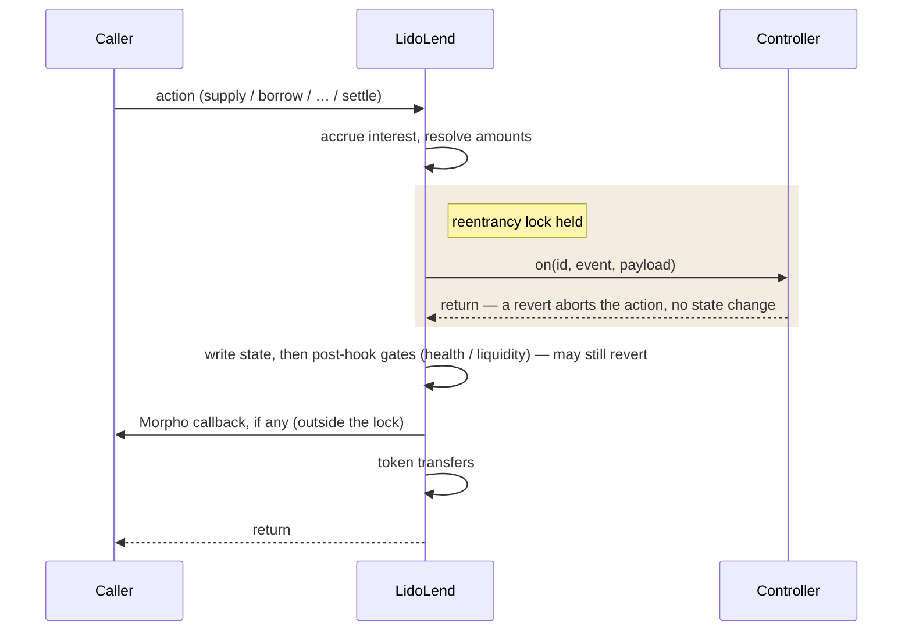

# LidoLend Specification

LidoLend is a Morpho Blue fork. It keeps the Morpho isolated-market accounting and adds two main features:

1. **Market controllers** — a market can be created with a controller contract bound to it. The core calls the controller before applying each market action, so custom policy can be enforced per action without touching user tokens.
2. **`settle`** — a settlement primitive that lets a lender exit by canceling borrower debt against its supply shares.

Two further changes:

3. **Owner-gated market creation** — upstream creation is permissionless, with IRMs and LLTVs enabled separately. Here a single owner-only `createMarket` fixes everything about a market in one step.
4. **Proxy deployment** — constructor setup becomes a one-shot initializer, and the EIP-712 domain separator is computed at call time.

## Contents

- [Inherited Behavior](#inherited-behavior)
- [Market Creation](#market-creation)
- [Controller Hooks](#controller-hooks)
- [Settlement](#settlement)
- [Proxy And Storage](#proxy-and-storage)
- [Trust Assumptions](#trust-assumptions)
- [Fork Delta](#fork-delta)
- [References](#references)
- [API Reference](#api-reference)

## Inherited Behavior

Behavior not listed in this spec matches Morpho Blue at the pinned commit (`morpho-org/morpho-blue` @ `1478e9cfe1b4d514f80682b3b60e4e12ff3ee45a`, `src/Morpho.sol`). The whitepaper and upstream source are the normative reference for it. The rest of this section is a non-normative recap of the inherited model.

A market is identified by `Id = keccak256(MarketParams)`, where `MarketParams` is the loan token, collateral token, oracle, IRM (interest rate model), and LLTV (liquidation loan-to-value). Markets are isolated: positions and accounting are per-market, and collateral and debt are not shared across markets.

Lenders supply loan assets and hold supply shares. Borrowers post collateral and hold borrow shares. Share ↔ asset conversions use virtual balances, so empty markets divide safely and share-price inflation attacks are unprofitable. Separately, every conversion rounds against the caller. What the caller receives rounds down and what the caller owes or surrenders rounds up, so the residual stays with the market rather than with the caller.

Interest accrues lazily, on `setFee` and every action that touches a market's positions or totals, except `supplyCollateral`. Anyone can also trigger an accrual directly with the external `accrueInterest`. Accrued interest is `totalBorrowAssets × wTaylorCompounded(borrowRate, elapsed)`, an approximation of continuous compounding. The same amount is added to both total borrow and total supply assets: borrowers owe it, lenders earn it. A market fee (owner-set, capped by `MAX_FEE`) is credited by minting supply shares to `feeRecipient`, diluting lenders instead of diverting assets. Markets with the zero-address IRM accrue nothing.

A position is liquidatable when its debt exceeds `LLTV × collateral value` at the oracle price. The liquidator's premium is the liquidation incentive factor `LIF`, bounded above and derived from the market's LLTV (see `ConstantsLib`), with no close factor. A liquidation that empties the collateral socializes the residual debt across lenders.

`onBehalf` actions require authorization (`setAuthorization` or an EIP-712 signature). Upstream, an authorized operator can borrow, withdraw, and withdraw collateral on behalf of the authorizer. This fork additionally lets it spend the authorizer's supply shares via `settle`.

`flashLoan` can lend any amount up to the contract's balance of a token — a balance that spans all markets — for one transaction, fee-free.

A market created with no controller dispatches no hook of its own. Beyond owner-gated creation and the proxy-related changes, its one behavioral difference from upstream is the global hook lock: its actions revert while another market's hook is in flight (see Controller Hooks).

## Market Creation

A Morpho market is defined entirely by its `MarketParams`: the loan token, the collateral token, the oracle, the IRM, and the LLTV. The market id is the hash of exactly those five fields (`keccak256(MarketParams)`). LidoLend gives each market two more values, a controller and a `settle` opt-in, but keeps them out of `MarketParams`, so the id and the way integrations derive it stay identical to Morpho.

Keeping the controller out of the id has a consequence. One set of `MarketParams` is still one market, so it can carry only one controller, bound when the market is created and never changed afterward. Choosing that controller is therefore a one-time decision, and that is why creation is restricted to the owner where upstream Morpho lets anyone create a market: the binding has to be the owner's call rather than a race to create first. The core can only check that a controller was built for the market it is bound to, not that its policy is sound, so the owner also vets the market's dependencies (see Trust Assumptions).

Because only the owner creates markets, the separate upstream step of enabling IRMs and LLTVs (`enableIrm` and `enableLltv`) is no longer needed and has been removed. Instead `createMarket` enables a market's IRM and LLTV on its own, still emitting the upstream `EnableIrm` and `EnableLltv` events on an IRM's or LLTV's first use. The `isIrmEnabled` and `isLltvEnabled` views still answer, but their meaning shifts: where upstream they were a pre-creation allowlist the owner curated, here they simply report whether some created market already uses that IRM or LLTV.

A market is created through one of two calls. `createMarket(params)` makes a plain market that has no controller and on which `settle` is unavailable. `createMarket(params, controller, enableSettlement)` makes a controlled market and rejects a zero controller (reverts `zero address`). Both bind their values permanently, with no setter to change them afterward:

- `marketController[id]` holds the controller. Its `marketId()` must match the id being created, or creation reverts with `controller mismatch`. Binding it emits `SetMarketController`.
- `isSettlementEnabled[id]` holds the `settle` opt-in. It can be set only in the controlled call, so settlement always comes with a controller. Enabling it emits `EnableSettlement`.

Everything else about creation is inherited. The LLTV must be below 100% (`max LLTV exceeded` — the check `enableLltv` used to run), the market must not already exist, `IIrm.borrowRate` runs once so a stateful IRM can initialize, and the upstream `CreateMarket` event is emitted.

## Controller Hooks

The core is not responsible for policy — which actions are allowed, for whom, when, and at what size. That lives in the market's controller. To the core a controller is two functions: `marketId()`, the single market it is bound to, and `on(id, event, payload)`, the entrypoint the core calls before each action. The core never reads controller state, so this is the only coupling.

Before applying an action the core calls `on` with one ABI-encoded struct per event (`SupplyHookData`, `BorrowHookData`, and so on, defined in `ILidoLendMarketController.sol`). A revert from the controller aborts the action with no state change. That revert is the controller's only hold on the action it is hooking, and it cannot rewrite the resolved amounts or partially allow the action. It is not a lock on the whole core, as the two properties below make precise.



The tail of the diagram is schematic. The exact order of token transfers and the Morpho callback is per-action and unchanged from upstream — `liquidate`, for one, sends the seized collateral before its callback and pulls the loan repayment after.

Two properties keep this safe. The hook fires after interest accrual and after the amounts are fully resolved, but before any state change or transfer, so the controller sees final numbers it cannot then alter. And a single transient lock is held for the length of `on`, so while a hook runs, re-entering any hooked action reverts with `hook reentrancy`. The check sits in the dispatch that every action calls, so this also blocks an action on a different market or one with no controller. The lock guards only the hooked actions, so from inside a hook a controller can still reach `flashLoan` and the authorization calls, which dispatch no hook.

A few actions deviate from that timing:

- `supplyCollateral` accrues no interest (collateral does not affect it), so its hook sees a stale interest state.
- External `accrueInterest` fires the hook before accruing, since there is nothing to resolve.
- Fee shares minted to `feeRecipient` during accrual fire no hook, and the owner's `setFee` accrues interest (so it may mint those shares) with no hook at all. A controller that mirrors supply totals must account for that drift.
- `flashLoan` has no hook at all, so any settle-relevant policy has to live on the hooks of the actions an attacker would eventually call.

The `HookEvent` enum and the payload structs are defined in `ILidoLendMarketController.sol`, and their order and layout are append-only: the controller decodes each payload by event, so reordering or reshaping would silently misroute every deployed controller.

The hook is not the last gate. The inherited post-mutation checks (withdraw and borrow liquidity, borrow and withdraw-collateral health) still run after it, and a revert there rolls back the controller too. The obligation also runs the other way: policy must respect the flows its market serves, since a controller that vetoes `withdraw` for a vault bricks that vault's reallocation.

## Settlement

`settle` lets a lender exit through a borrower's position. The caller specifies an exact `borrowShares` cut. The core cancels those shares from `borrower`, burns the corresponding supply shares from `onBehalf`, and transfers to `receiver` the collateral that cut is worth at the oracle price, with no liquidation incentive (`LIF = 1`). Passing the borrower's complete share balance closes its debt position to zero, unless that whole balance is worth too little to seize any collateral, in which case the call reverts and the holding stays open. Such a holding can still be cleared with `repay` or `liquidate`. `onBehalf` and `borrower` may be the same address, so a lender that also borrows can settle against its own position.

Settlement is not an exact value swap. The debt removal prices the cut rounding up while the seizure prices the same cut rounding down, so the seizure can rest on a value one loan-asset unit below the debt canceled. That gap is borne by the settling side, which burns supply for the rounded-up amount while `receiver` collects collateral for the rounded-down one.

The core derives the remaining amounts in this order:

1. `borrowAssetsCanceled = borrowShares.toAssetsUp(totalBorrowAssets, totalBorrowShares)`.
   - The exact debt-share cut is valued rounding up, so a full-share close covers its complete rounded asset obligation.
   - The difference from the ideal fractional value is less than one loan-asset unit, independently of the borrow-share price.
   - That round-up can put `borrowAssetsCanceled` one loan-asset unit above `totalBorrowAssets`, and never more. This is the same overshoot `repay` and `liquidate` allow.
2. `supplySharesBurned = borrowAssetsCanceled.toSharesUp(totalSupplyAssets, totalSupplyShares)`.
   - The supply burn rounds up so the settling lender cannot retain a residual claim backed by assets removed from the market.
   - The difference is less than one raw supply share, whose asset value grows with the supply-share price and is not bounded by one asset unit.
3. `seizedAssets = borrowShares.toAssetsDown(totalBorrowAssets, totalBorrowShares).mulDivDown(ORACLE_PRICE_SCALE, oraclePrice)`.
   - The seizure prices the same share cut rounding down, and the price conversion rounds down again, so settlement never seizes more collateral than the canceled debt is worth at the oracle price. `liquidate` derives a share-specified seizure the same way, from the repaid shares valued rounding down.
   - A cut whose rounded-down value buys less than one collateral unit at the oracle price seizes nothing and reverts `settlement slice too small`. The floor on a settleable cut is therefore the loan-asset value of one collateral unit, which rises as the collateral grows more valuable relative to the loan token.

No loan tokens move. `totalSupplyAssets` falls by `borrowAssetsCanceled` and `totalBorrowAssets` falls by the same amount floored at zero, so outside the one-unit overshoot both totals move together and free liquidity is invariant. In the overshoot case the floor leaves free liquidity one unit lower, which the market must already hold or the checked supply write reverts. The borrower's exact share delta, the lender's derived share delta, and the collateral delta are included in the `Settle` hook payload before any accounting writes. A controller that recomputes post-cut totals from that payload has to apply the same zero floor to `totalBorrowAssets` rather than subtracting directly.

The core enforces `borrowShares <= position[id][borrower].borrowShares` and `supplySharesBurned <= position[id][onBehalf].supplyShares`. Settlement can only be enabled on a market with a non-zero controller, and its `Settle` hook may impose additional eligibility rules by returning or reverting.

The pre-resolution checks run in this order: market exists, settlement is enabled, `borrowShares != 0`, receiver is non-zero, and the caller is authorized for `onBehalf`. A zero share cut reverts `settlement slice too small`. After accrual and amount derivation, the settle-specific gates are:

1. `settlement exceeds debt` — the exact input exceeds the borrower's debt shares.
2. `settlement exceeds supply` — the derived upward-rounded supply burn exceeds `onBehalf`'s owned supply shares.
3. `settlement slice too small` — the derived seizure is zero, either because the cut's rounded-down asset value is zero or because the price conversion floors the seizure to zero.
4. `settlement exceeds collateral` — the derived seizure exceeds the borrower's collateral.

**Exact share writes, a floored debt-asset write.** The two gates constrain different things, so the two asset decrements are not symmetric.

```solidity
supplySharesBurned = borrowAssetsCanceled.toSharesUp(totalSupplyAssets, totalSupplyShares);
require(supplySharesBurned <= position[id][onBehalf].supplyShares);   // settlement exceeds supply
require(borrowShares <= position[id][borrower].borrowShares);         // settlement exceeds debt

totalSupplyAssets -= borrowAssetsCanceled;
totalBorrowAssets = UtilsLib.zeroFloorSub(totalBorrowAssets, borrowAssetsCanceled);
```

The supply gate constrains a value derived from `borrowAssetsCanceled`, and that conversion passes `totalSupplyShares` as soon as the amount passes `totalSupplyAssets`, so clearing the gate already proves the supply decrement fits. The debt gate constrains the input share cut, which says nothing about the asset value rounded up from it, so `borrowAssetsCanceled` can land one loan-asset unit above `totalBorrowAssets`. `repay` and `liquidate` floor that same write for the same reason. Reaching the overshoot needs a borrow-share price below the value it starts at, which sub-unit `repay` and `settle` calls produce.

**Worked examples.** The first two share one market at a 1:1 oracle price, drifted by interest so both asset totals read 13 against 12e6 shares. The third stands on its own.

- *Close one of two borrowers.* A borrower owns 7e6 shares and the other owns 5e6. The first holding's ideal value is about 7.54 once the virtual balances are folded in, so settlement cancels 8 assets, burns exactly 7e6 borrow shares, and derives a 7,428,572 supply-share burn. The seizure prices the same holding rounding down, at 7, and takes 7 collateral at a 1:1 oracle price, so the settling side absorbs the one unit between the two valuations. The other borrower's shares are untouched, and its rounded debt falls from 6 to 5 because both borrow totals changed by the exact settlement deltas.
- *Ownership boundary.* If a sole borrower owns all 12e6 debt shares, closing it after the same drift cancels 13 assets. If that requires 12,071,429 supply shares while the lender owns only 12e6, settlement reverts `settlement exceeds supply`, and the caller must submit a smaller exact borrow-share cut.
- *Non-1:1 collateral price, on a market large enough for the figures.* At `oraclePrice = 3e36`, a cut whose rounded-down value is 100 loan units seizes 33 collateral units, and the fractional remainder stays with the borrower.

An expensive raw borrow share does not create an assets-to-borrow-shares mismatch because the share count is the input. It does increase the minimum non-zero economic cut: settlement cannot cancel a fraction of one raw borrow share.

The core performs **no health check on the borrower**. It therefore does not distinguish healthy, unhealthy-but-solvent, and insolvent borrowers when evaluating a settlement. Any additional acceptance condition can only arise when the controller hook returns or reverts, and the criteria used by that controller are outside the core specification.

A cut removes `X` from both market asset totals. Borrower LTV `D/C` moves approximately to `(D−X)/(C−X)` — down for a solvent borrower, up for an insolvent one. The controller receives the exact share, asset, and collateral deltas before the writes and can evaluate the resulting state when enforcing any policy.

| Borrower | LTV before | cut `X` | LTV after |
| --- | --- | --- | --- |
| solvent (`D < C`) | 80 / 100 = 0.80 | 40 | 40 / 60 = 0.67 ↓ |
| insolvent (`D > C`) | 120 / 100 = 1.20 | 50 | 70 / 50 = 1.40 ↑ |

So a cut heals a solvent position (par, no penalty — milder than liquidation), but a cut on a bad-debt position concentrates the shortfall on the remaining collateral. The core does not reject either case based on LTV.

`settle` never realizes bad debt: unlike `liquidate`, a cut that empties the collateral leaves residual borrow shares in place, to be socialized only by a subsequent liquidation. Liquidation remains the path for ordinary unhealthy positions, and settlement does not replace it.

## Proxy And Storage

LidoLend runs behind `OssifiableProxy`. Two upstream constructs are reshaped for delegatecall:

- The constructor-based owner setup becomes `initialize(address newOwner)`: one-shot (reverts `already initialized` on repeat), sets a non-zero owner (`zero address` otherwise), emits `SetOwner`. The implementation's constructor sets `isInitialized = true`, so the bare implementation is permanently uninitializable and unownable. Only proxies, which start at `false`, can initialize.
- `DOMAIN_SEPARATOR` is a view function recomputing `keccak256(DOMAIN_TYPEHASH, chainid, address(this))` per call. EIP-712 authorization signatures therefore bind to the proxy address (invalid against the implementation's domain, and vice versa). Tracking the live `block.chainid` also means that after a chain split the separator follows the post-split id, invalidating pre-split signatures on the chain whose id changes — the inverse of upstream's bake-once replay warning.

Storage layout is append-only — under a proxy this is load-bearing:

| Slots | Variables | Origin |
| --- | --- | --- |
| 0–8 | `owner`, `feeRecipient`, `position`, `market`, `isIrmEnabled`, `isLltvEnabled`, `isAuthorized`, `nonce`, `idToMarketParams` | upstream, unchanged order |
| 9 | `marketController` | fork |
| 10 | `isSettlementEnabled` | fork |
| 11 | `isInitialized` | fork |

The layout is a single linear sequence from slot 0, and `OssifiableProxy` keeps its own implementation and admin pointers in EIP-1967 slots that do not collide with it, so the proxy never writes any of slots 0–11. New fields must be appended after `isInitialized`, never inserted. The hook-reentrancy lock is transient storage and occupies no slot. Transient storage (EIP-1153) needs an EVM at Cancun or later. The fork builds with `evm_version = "cancun"` and Solidity 0.8.36 (above upstream's 0.8.19), so the target chain must support Cancun. Fork-added revert strings and events are appended in place to the upstream `ErrorsLib` and `EventsLib`.

## Trust Assumptions

This section states what each actor can do to this contract. Governance design — who holds each role and through what process it acts — is outside this core spec.

**Proxy admin** can replace the implementation — total power over state and funds. This is the largest departure from upstream, whose contract is immutable and whose governance cannot manage funds. The trade is deliberate, and constraints on the admin (timelocks, governance) are an operational matter outside this spec.

**Owner** creates markets, sets the fee (capped by `MAX_FEE`) and the fee recipient, and transfers ownership. It cannot seize principal or touch positions directly. The fee is the one lever that moves value: within `MAX_FEE`, each interest accrual mints supply shares to the fee recipient, who can then withdraw them, so the owner can divert a bounded slice of interest but never the deposited principal. Vetting each market's dependencies against the list below is the owner's duty, since creation is owner-gated.

**Controller** is trusted by construction. It can veto every hooked action — a broken or malicious controller freezes its market, and since the binding is immutable, recovery requires upgrading the core or the controller itself. Hooks give it no handles on funds or accounting: it is called, holds no approvals, and owns no core state — though it may keep its own state (e.g. a borrower-eligibility queue or per-user watermarks), update it inside the hook (`on` is not `view`), and expose it for reads. The core neither writes nor depends on it. The reentrancy window the hook call opens is closed mechanically by the transient lock (see Controller Hooks). Inherited user callbacks fire after state mutations, outside the lock, and keep the upstream semantics.

**Oracle and IRM** carry the upstream trust: the oracle prices collateral for health, liquidation, and `settle` alike (settlement adds no new oracle power — same price, no incentive), and the IRM prices time.

**Tokens and dependencies** must satisfy the upstream assumption list (`IMorphoBase.createMarket` NatSpec). Tokens are ERC-20 compliant (return values may be omitted) and change balances only by the exact transferred amount — no transfer fees, no burns, and **no rebasing** (stETH does not qualify, wstETH does). Neither token, IRM, nor oracle re-enters the core. Supplied and borrowed amounts stay below ~1e32, and the oracle is correctly scaled and cannot instantly drop by more than `LLTV × LIF`.

**Callback callers** (`supply`, `repay`, `supplyCollateral`, `liquidate`, `flashLoan` with `data`) keep the inherited reentrancy surface. A callback that re-enters the core runs the nested action through hooks.

## Fork Delta

The per-function API reference lives in API Reference below, generated from natspec. This section is only the list of intentional changes from upstream `1478e9cf`.

- **New functions:** `settle`, `initialize`, the three-argument `createMarket`, and the `marketController` / `isSettlementEnabled` / `isInitialized` getters.
- **Owner-gated creation:** both `createMarket` overloads are `onlyOwner`. `enableIrm` / `enableLltv` are removed, and creation enables the IRM and LLTV itself.
- **Controller hooks:** the nine state-changing actions dispatch the bound controller before mutating state, under a transient reentrancy lock.
- **Proxy:** `DOMAIN_SEPARATOR` is recomputed per call, and constructor petrification plus `initialize` replace the upstream constructor.
- **Storage:** `marketController`, `isSettlementEnabled`, and `isInitialized` are appended at slots 9–11.
- **Errors and events:** the fork-added ones are appended in place to `ErrorsLib` and `EventsLib`.

Every other inherited function body is unchanged from upstream — the rest of the source diff is the contract rename, import paths, and comments.

## References

- Morpho Blue source at the pinned commit and [`morpho-blue-whitepaper.pdf`](./morpho-blue-whitepaper.pdf) — normative for inherited behavior.
- `FORK_NOTES.md` — canonical record of the fork point and delta.
- `TEST_PLAN.md` — the property-to-test map for the behavior specified here.
- `src/interfaces/ILidoLendMarketController.sol` — normative hook ABI.
- `src/interfaces/ILidoLend.sol` — typed core surface for consumers. `ILidoLend` is struct-returning (`is IMorpho`), so it works directly with the Morpho periphery libraries.
- API Reference below — the contract reference, generated from the solc AST by `make doc`.
- Each market controller's own documentation — the policy it enforces through the hooks.

## API Reference

<!-- BEGIN AUTOGENERATED API: generated from solc artifacts — do not edit by hand, regenerate with `make doc` -->

### Types

#### `Id`

```solidity
type Id is bytes32
```

A market identifier, the `keccak256` hash of a `MarketParams`.

#### `MarketParams`

```solidity
struct MarketParams {
    address loanToken;
    address collateralToken;
    address oracle;
    address irm;
    uint256 lltv;
}
```

#### `Position`

```solidity
struct Position {
    uint256 supplyShares;
    uint128 borrowShares;
    uint128 collateral;
}
```

> [!WARNING]
> For `feeRecipient`, `supplyShares` does not contain the accrued shares since the last interest accrual.

#### `Market`

```solidity
struct Market {
    uint128 totalSupplyAssets;
    uint128 totalSupplyShares;
    uint128 totalBorrowAssets;
    uint128 totalBorrowShares;
    uint128 lastUpdate;
    uint128 fee;
}
```

> [!WARNING]
> `totalSupplyAssets` does not contain the accrued interest since the last interest accrual.

> [!WARNING]
> `totalBorrowAssets` does not contain the accrued interest since the last interest accrual.

> [!WARNING]
> `totalSupplyShares` does not contain the additional shares accrued by `feeRecipient` since the last interest accrual.

#### `Authorization`

```solidity
struct Authorization {
    address authorizer;
    address authorized;
    bool isAuthorized;
    uint256 nonce;
    uint256 deadline;
}
```

#### `Signature`

```solidity
struct Signature {
    uint8 v;
    bytes32 r;
    bytes32 s;
}
```

### `LidoLend`

The LidoLend contract: a Morpho Blue fork with per-market controller hooks and a `settle` primitive.

#### Functions

##### `constructor`

```solidity
constructor();
```

Locks the implementation contract when it is deployed, preventing it from being initialized.

##### `initialize`

```solidity
function initialize(address newOwner) external;
```

**Parameters**

| Name | Type | Description |
| --- | --- | --- |
| `newOwner` | `address` | The new owner of the contract. |

Initializes the contract, setting `newOwner` as `owner`.

Can only be called once. The implementation contract cannot be initialized.

##### `setOwner`

```solidity
function setOwner(address newOwner) external;
```

Sets `newOwner` as `owner` of the contract.

> [!WARNING]
> No two-step transfer ownership.

> [!WARNING]
> The owner can be set to the zero address.

##### `setFee`

```solidity
function setFee(MarketParams memory marketParams, uint256 newFee) external;
```

**Parameters**

| Name | Type | Description |
| --- | --- | --- |
| `marketParams` | `MarketParams` |  |
| `newFee` | `uint256` | The new fee, scaled by WAD. |

Sets the `newFee` for the given market `marketParams`.

> [!WARNING]
> The recipient can be the zero address.

##### `setFeeRecipient`

```solidity
function setFeeRecipient(address newFeeRecipient) external;
```

Sets `newFeeRecipient` as `feeRecipient` of the fee.

> [!WARNING]
> If the fee recipient is set to the zero address, fees will accrue there and will be lost.

Modifying the fee recipient will allow the new recipient to claim any pending fees not yet accrued. To ensure that the current recipient receives all due fees, accrue interest manually prior to making any changes.

##### `createMarket`

```solidity
function createMarket(MarketParams memory marketParams) external;
```

Creates the market `marketParams`.

Here is the list of assumptions on the market's dependencies (tokens, IRM and oracle) that guarantees Morpho behaves as expected:

- The token should be ERC-20 compliant, except that it can omit return values on `transfer` and `transferFrom`.
- The token balance of Morpho should only decrease on `transfer` and `transferFrom`. In particular, tokens with burn functions are not supported.
- The token should not re-enter Morpho on `transfer` nor `transferFrom`.
- The token balance of the sender (resp. receiver) should decrease (resp. increase) by exactly the given amount on `transfer` and `transferFrom`. In particular, tokens with fees on transfer are not supported.
- The IRM should not re-enter Morpho.
- The oracle should return a price with the correct scaling.
- The oracle price should not be able to change instantly such that the new price is less than the old price multiplied by LLTV*LIF. In particular, if the loan asset is a vault that can receive donations, the oracle should not price its shares using the AUM.

Here is a list of assumptions on the market's dependencies which, if broken, could break Morpho's liveness properties (funds could get stuck):

- The token should not revert on `transfer` and `transferFrom` if balances and approvals are right.
- The amount of assets supplied and borrowed should not be too high (max ~1e32), otherwise the number of shares might not fit within 128 bits.
- The IRM should not revert on `borrowRate`.
- The IRM should not return a very high borrow rate (otherwise the computation of `interest` in `_accrueInterest` can overflow).
- The oracle should not revert `price`.
- The oracle should not return a very high price (otherwise the computation of `maxBorrow` in `_isHealthy` or of `assetsRepaid` in `liquidate` can overflow).

The borrow share price of a market with less than 1e4 assets borrowed can be decreased by manipulations, to the point where `totalBorrowShares` is very large and borrowing overflows.

> [!WARNING]
> Can only be called by the owner. The created market has no controller. See the overload in `ILidoLend`.

##### `createMarket`

```solidity
function createMarket(
    MarketParams memory marketParams,
    address controller,
    bool enableSettlement
) external;
```

**Parameters**

| Name | Type | Description |
| --- | --- | --- |
| `marketParams` | `MarketParams` | The market to create. |
| `controller` | `address` | The controller of the market. Must be non-zero. |
| `enableSettlement` | `bool` | Whether `settle` is enabled on the market. |

Creates the market `marketParams` with `controller` bound and, if `enableSettlement`, `settle` enabled.

> [!WARNING]
> This function is `onlyOwner`, and the single-argument `createMarket` is the only way to create a market without a controller.

The controller and the settlement flag cannot be changed after creation.

##### `_createMarket`

```solidity
function _createMarket(
    MarketParams memory marketParams,
    address controller,
    bool enableSettlement
) internal;
```

Creates the market `marketParams`, binding `controller` and the settlement opt-in.

Assumes that `enableSettlement` is true only when `controller` is non-zero: settlement cannot be enabled on a market without a controller.

##### `supply`

```solidity
function supply(
    MarketParams memory marketParams,
    uint256 assets,
    uint256 shares,
    address onBehalf,
    bytes calldata data
) external returns (uint256, uint256);
```

**Parameters**

| Name | Type | Description |
| --- | --- | --- |
| `marketParams` | `MarketParams` | The market to supply assets to. |
| `assets` | `uint256` | The amount of assets to supply. |
| `shares` | `uint256` | The amount of shares to mint. |
| `onBehalf` | `address` | The address that will own the increased supply position. |
| `data` | `bytes` | Arbitrary data to pass to the `onMorphoSupply` callback. Pass empty data if not needed. |

**Returns**

| Name | Type | Description |
| --- | --- | --- |
| `<none>` | `uint256` | assetsSupplied The amount of assets supplied. |
| `<none>` | `uint256` | sharesSupplied The amount of shares minted. |

Supplies `assets` or `shares` on behalf of `onBehalf`, optionally calling back the caller's `onMorphoSupply` function with the given `data`.

Either `assets` or `shares` should be zero. Most use cases should rely on `assets` as an input so the caller is guaranteed to have `assets` tokens pulled from their balance, but the possibility to mint a specific amount of shares is given for full compatibility and precision.

Supplying a large amount can revert for overflow.

Supplying an amount of shares may lead to supply more or fewer assets than expected due to slippage. Consider using the `assets` parameter to avoid this.

> [!WARNING]
> On a market with a controller, this function calls the controller's `Supply` hook after interest accrual and before applying the state changes, and reverts when reentered from a controller hook. The hook itself may revert.

##### `withdraw`

```solidity
function withdraw(
    MarketParams memory marketParams,
    uint256 assets,
    uint256 shares,
    address onBehalf,
    address receiver
) external returns (uint256, uint256);
```

**Parameters**

| Name | Type | Description |
| --- | --- | --- |
| `marketParams` | `MarketParams` | The market to withdraw assets from. |
| `assets` | `uint256` | The amount of assets to withdraw. |
| `shares` | `uint256` | The amount of shares to burn. |
| `onBehalf` | `address` | The address of the owner of the supply position. |
| `receiver` | `address` | The address that will receive the withdrawn assets. |

**Returns**

| Name | Type | Description |
| --- | --- | --- |
| `<none>` | `uint256` | assetsWithdrawn The amount of assets withdrawn. |
| `<none>` | `uint256` | sharesWithdrawn The amount of shares burned. |

Withdraws `assets` or `shares` on behalf of `onBehalf` and sends the assets to `receiver`.

Either `assets` or `shares` should be zero. To withdraw max, pass the `shares`'s balance of `onBehalf`.

`msg.sender` must be authorized to manage `onBehalf`'s positions.

Withdrawing an amount corresponding to more shares than supplied will revert for underflow.

It is advised to use the `shares` input when withdrawing the full position to avoid reverts due to conversion roundings between shares and assets.

> [!WARNING]
> On a market with a controller, this function calls the controller's `Withdraw` hook after interest accrual and before applying the state changes, and reverts when reentered from a controller hook. The hook itself may revert.

##### `borrow`

```solidity
function borrow(
    MarketParams memory marketParams,
    uint256 assets,
    uint256 shares,
    address onBehalf,
    address receiver
) external returns (uint256, uint256);
```

**Parameters**

| Name | Type | Description |
| --- | --- | --- |
| `marketParams` | `MarketParams` | The market to borrow assets from. |
| `assets` | `uint256` | The amount of assets to borrow. |
| `shares` | `uint256` | The amount of shares to mint. |
| `onBehalf` | `address` | The address that will own the increased borrow position. |
| `receiver` | `address` | The address that will receive the borrowed assets. |

**Returns**

| Name | Type | Description |
| --- | --- | --- |
| `<none>` | `uint256` | assetsBorrowed The amount of assets borrowed. |
| `<none>` | `uint256` | sharesBorrowed The amount of shares minted. |

Borrows `assets` or `shares` on behalf of `onBehalf` and sends the assets to `receiver`.

Either `assets` or `shares` should be zero. Most use cases should rely on `assets` as an input so the caller is guaranteed to borrow `assets` of tokens, but the possibility to mint a specific amount of shares is given for full compatibility and precision.

`msg.sender` must be authorized to manage `onBehalf`'s positions.

Borrowing a large amount can revert for overflow.

Borrowing an amount of shares may lead to borrow fewer assets than expected due to slippage. Consider using the `assets` parameter to avoid this.

> [!WARNING]
> On a market with a controller, this function calls the controller's `Borrow` hook after interest accrual and before applying the state changes, and reverts when reentered from a controller hook. The hook itself may revert.

##### `repay`

```solidity
function repay(
    MarketParams memory marketParams,
    uint256 assets,
    uint256 shares,
    address onBehalf,
    bytes calldata data
) external returns (uint256, uint256);
```

**Parameters**

| Name | Type | Description |
| --- | --- | --- |
| `marketParams` | `MarketParams` | The market to repay assets to. |
| `assets` | `uint256` | The amount of assets to repay. |
| `shares` | `uint256` | The amount of shares to burn. |
| `onBehalf` | `address` | The address of the owner of the debt position. |
| `data` | `bytes` | Arbitrary data to pass to the `onMorphoRepay` callback. Pass empty data if not needed. |

**Returns**

| Name | Type | Description |
| --- | --- | --- |
| `<none>` | `uint256` | assetsRepaid The amount of assets repaid. |
| `<none>` | `uint256` | sharesRepaid The amount of shares burned. |

Repays `assets` or `shares` on behalf of `onBehalf`, optionally calling back the caller's `onMorphoRepay` function with the given `data`.

Either `assets` or `shares` should be zero. To repay max, pass the `shares`'s balance of `onBehalf`.

Repaying an amount corresponding to more shares than borrowed will revert for underflow.

It is advised to use the `shares` input when repaying the full position to avoid reverts due to conversion roundings between shares and assets.

An attacker can front-run a repay with a small repay making the transaction revert for underflow.

> [!WARNING]
> On a market with a controller, this function calls the controller's `Repay` hook after interest accrual and before applying the state changes, and reverts when reentered from a controller hook. The hook itself may revert.

##### `supplyCollateral`

```solidity
function supplyCollateral(
    MarketParams memory marketParams,
    uint256 assets,
    address onBehalf,
    bytes calldata data
) external;
```

**Parameters**

| Name | Type | Description |
| --- | --- | --- |
| `marketParams` | `MarketParams` | The market to supply collateral to. |
| `assets` | `uint256` | The amount of collateral to supply. |
| `onBehalf` | `address` | The address that will own the increased collateral position. |
| `data` | `bytes` | Arbitrary data to pass to the `onMorphoSupplyCollateral` callback. Pass empty data if not needed. |

Supplies `assets` of collateral on behalf of `onBehalf`, optionally calling back the caller's `onMorphoSupplyCollateral` function with the given `data`.

Interest is not accrued since it's not required and it saves gas.

Supplying a large amount can revert for overflow.

> [!WARNING]
> On a market with a controller, this function calls the controller's `SupplyCollateral` hook before applying the state changes (no interest is accrued), and reverts when reentered from a controller hook. The hook itself may revert.

##### `withdrawCollateral`

```solidity
function withdrawCollateral(
    MarketParams memory marketParams,
    uint256 assets,
    address onBehalf,
    address receiver
) external;
```

**Parameters**

| Name | Type | Description |
| --- | --- | --- |
| `marketParams` | `MarketParams` | The market to withdraw collateral from. |
| `assets` | `uint256` | The amount of collateral to withdraw. |
| `onBehalf` | `address` | The address of the owner of the collateral position. |
| `receiver` | `address` | The address that will receive the collateral assets. |

Withdraws `assets` of collateral on behalf of `onBehalf` and sends the assets to `receiver`.

`msg.sender` must be authorized to manage `onBehalf`'s positions.

Withdrawing an amount corresponding to more collateral than supplied will revert for underflow.

> [!WARNING]
> On a market with a controller, this function calls the controller's `WithdrawCollateral` hook after interest accrual and before applying the state changes, and reverts when reentered from a controller hook. The hook itself may revert.

##### `settle`

```solidity
function settle(
    MarketParams memory marketParams,
    uint256 borrowShares,
    address onBehalf,
    address borrower,
    address receiver
) external returns (uint256 seizedAssets, uint256 borrowAssetsCanceled, uint256 borrowSharesCanceled, uint256 supplySharesBurned);
```

**Parameters**

| Name | Type | Description |
| --- | --- | --- |
| `marketParams` | `MarketParams` | The market to settle on. |
| `borrowShares` | `uint256` | The exact amount of `borrower`'s debt shares to cancel. |
| `onBehalf` | `address` | The address of the owner of the supply position. |
| `borrower` | `address` | The address of the owner of the debt position. |
| `receiver` | `address` | The address that will receive the seized collateral. |

**Returns**

| Name | Type | Description |
| --- | --- | --- |
| `seizedAssets` | `uint256` | The amount of collateral seized and sent to `receiver`, priced from the canceled shares rounded down. |
| `borrowAssetsCanceled` | `uint256` | The amount of debt canceled, in loan-token assets, priced from the canceled shares rounded up. It can exceed the market's `totalBorrowAssets` by one unit, which the core floors at zero when it applies the cut. |
| `borrowSharesCanceled` | `uint256` | The count of `borrower`'s debt shares canceled. |
| `supplySharesBurned` | `uint256` | The amount of `onBehalf`'s supply shares burned. |

Cancels exactly `borrowShares` from `borrower`, derives the corresponding debt assets and `onBehalf` supply-share burn with upward rounding, and seizes to `receiver` the collateral that cut is worth with downward rounding. The gap between the two valuations is at most one loan-asset unit and it is borne by the settling side, so a cut that buys less than one collateral unit at the oracle price seizes nothing and reverts. Passing the borrower's complete debt-share balance closes the debt position to zero, unless that balance itself falls under that floor.

`msg.sender` must be authorized to manage `onBehalf`'s positions.

Settlement must be enabled on the market.

The derived supply-share burn cannot exceed `onBehalf`'s owned supply shares.

> [!WARNING]
> This function calls the controller's `Settle` hook after interest accrual and before applying the state changes, and reverts when reentered from a controller hook. The hook itself may revert.

##### `liquidate`

```solidity
function liquidate(
    MarketParams memory marketParams,
    address borrower,
    uint256 seizedAssets,
    uint256 repaidShares,
    bytes calldata data
) external returns (uint256, uint256);
```

**Parameters**

| Name | Type | Description |
| --- | --- | --- |
| `marketParams` | `MarketParams` | The market of the position. |
| `borrower` | `address` | The owner of the position. |
| `seizedAssets` | `uint256` | The amount of collateral to seize. |
| `repaidShares` | `uint256` | The amount of shares to repay. |
| `data` | `bytes` | Arbitrary data to pass to the `onMorphoLiquidate` callback. Pass empty data if not needed. |

**Returns**

| Name | Type | Description |
| --- | --- | --- |
| `<none>` | `uint256` | The amount of assets seized. |
| `<none>` | `uint256` | The amount of assets repaid. |

Liquidates the given `repaidShares` of debt asset or seize the given `seizedAssets` of collateral on the given market `marketParams` of the given `borrower`'s position, optionally calling back the caller's `onMorphoLiquidate` function with the given `data`.

Either `seizedAssets` or `repaidShares` should be zero.

Seizing more than the collateral balance will underflow and revert without any error message.

Repaying more than the borrow balance will underflow and revert without any error message.

An attacker can front-run a liquidation with a small repay making the transaction revert for underflow.

> [!WARNING]
> On a market with a controller, this function calls the controller's `Liquidate` hook after interest accrual and before applying the state changes, and reverts when reentered from a controller hook. The hook itself may revert.

##### `flashLoan`

```solidity
function flashLoan(address token, uint256 assets, bytes calldata data) external;
```

**Parameters**

| Name | Type | Description |
| --- | --- | --- |
| `token` | `address` | The token to flash loan. |
| `assets` | `uint256` | The amount of assets to flash loan. |
| `data` | `bytes` | Arbitrary data to pass to the `onMorphoFlashLoan` callback. |

Executes a flash loan.

Flash loans have access to the whole balance of the contract (the liquidity and deposited collateral of all markets combined, plus donations).

> [!WARNING]
> Not ERC-3156 compliant but compatibility is easily reached:

- `flashFee` is zero.
- `maxFlashLoan` is the token's balance of this contract.
- The receiver of `assets` is the caller.

##### `DOMAIN_SEPARATOR`

```solidity
function DOMAIN_SEPARATOR() public view returns (bytes32);
```

The EIP-712 domain separator.

> [!WARNING]
> Every EIP-712 signed message based on this domain separator can be reused on chains sharing the same chain id because the domain separator would be the same.

The separator is recomputed on every call.

##### `setAuthorization`

```solidity
function setAuthorization(address authorized, bool newIsAuthorized) external;
```

**Parameters**

| Name | Type | Description |
| --- | --- | --- |
| `authorized` | `address` | The authorized address. |
| `newIsAuthorized` | `bool` | The new authorization status. |

Sets the authorization for `authorized` to manage `msg.sender`'s positions.

##### `setAuthorizationWithSig`

```solidity
function setAuthorizationWithSig(
    Authorization memory authorization,
    Signature calldata signature
) external;
```

**Parameters**

| Name | Type | Description |
| --- | --- | --- |
| `authorization` | `Authorization` | The `Authorization` struct. |
| `signature` | `Signature` | The signature. |

Sets the authorization for `authorization.authorized` to manage `authorization.authorizer`'s positions.

> [!WARNING]
> Reverts if the signature has already been submitted.

The signature is malleable, but it has no impact on the security here.

The nonce is passed as argument to be able to revert with a different error message.

##### `_isSenderAuthorized`

```solidity
function _isSenderAuthorized(address onBehalf) internal view returns (bool);
```

Returns whether the sender is authorized to manage `onBehalf`'s positions.

##### `accrueInterest`

```solidity
function accrueInterest(MarketParams memory marketParams) external;
```

Accrues interest for the given market `marketParams`.

> [!WARNING]
> On a market with a controller, this function calls the controller's `AccrueInterest` hook before accruing interest, and reverts when reentered from a controller hook. The hook itself may revert.

##### `_accrueInterest`

```solidity
function _accrueInterest(MarketParams memory marketParams, Id id) internal;
```

Accrues interest for the given market `marketParams`.

Assumes that the inputs `marketParams` and `id` match.

##### `_isHealthy`

```solidity
function _isHealthy(
    MarketParams memory marketParams,
    Id id,
    address borrower
) internal view returns (bool);
```

Returns whether the position of `borrower` in the given market `marketParams` is healthy.

Assumes that the inputs `marketParams` and `id` match.

##### `_isHealthy`

```solidity
function _isHealthy(
    MarketParams memory marketParams,
    Id id,
    address borrower,
    uint256 collateralPrice
) internal view returns (bool);
```

Returns whether the position of `borrower` in the given market `marketParams` with the given `collateralPrice` is healthy.

Assumes that the inputs `marketParams` and `id` match.

Rounds in favor of the protocol, so one might not be able to borrow exactly `maxBorrow` but one unit less.

##### `_hook`

```solidity
function _hook(Id id, HookEvent hookEvent, bytes memory data) internal;
```

Reentrancy gate: while a hook is in flight, every hooked action reverts — including actions on markets with no controller.

##### `extSloads`

```solidity
function extSloads(
    bytes32[] calldata slots
) external view returns (bytes32[] memory res);
```

Returns the data stored on the different `slots`.

#### State variables

##### `owner`

```solidity
address public owner
```

The owner of the contract.

It has the power to change the owner.

It has the power to set fees on markets and set the fee recipient.

It has the power to create markets, which enables their IRMs and LLTVs.

##### `feeRecipient`

```solidity
address public feeRecipient
```

The fee recipient of all markets.

The recipient receives the fees of a given market through a supply position on that market.

##### `position`

```solidity
mapping(Id => mapping(address => Position)) public position
```

The state of the position of `user` on the market corresponding to `id`.

> [!WARNING]
> For `feeRecipient`, `supplyShares` does not contain the accrued shares since the last interest accrual.

##### `market`

```solidity
mapping(Id => Market) public market
```

The state of the market corresponding to `id`.

> [!WARNING]
> `totalSupplyAssets` does not contain the accrued interest since the last interest accrual.

> [!WARNING]
> `totalBorrowAssets` does not contain the accrued interest since the last interest accrual.

> [!WARNING]
> `totalSupplyShares` does not contain the accrued shares by `feeRecipient` since the last interest accrual.

##### `isIrmEnabled`

```solidity
mapping(address => bool) public isIrmEnabled
```

Whether the `irm` is enabled.

An IRM becomes enabled when the first market using it is created. It is not possible to disable an IRM.

##### `isLltvEnabled`

```solidity
mapping(uint256 => bool) public isLltvEnabled
```

Whether the `lltv` is enabled.

An LLTV becomes enabled when the first market using it is created. It is not possible to disable a LLTV.

##### `isAuthorized`

```solidity
mapping(address => mapping(address => bool)) public isAuthorized
```

Whether `authorized` is authorized to modify `authorizer`'s position on all markets.

Anyone is authorized to modify their own positions, regardless of this variable.

##### `nonce`

```solidity
mapping(address => uint256) public nonce
```

The `authorizer`'s current nonce. Used to prevent replay attacks with EIP-712 signatures.

##### `idToMarketParams`

```solidity
mapping(Id => MarketParams) public idToMarketParams
```

The market params corresponding to `id`.

This mapping is not used in Morpho. It is there to enable reducing the cost associated to calldata on layer 2s by creating a wrapper contract with functions that take `id` as input instead of `marketParams`.

##### `marketController`

```solidity
mapping(Id => address) public marketController
```

The controller of the market corresponding to `id`. Zero if the market has no controller.

Cannot be changed after market creation.

##### `isSettlementEnabled`

```solidity
mapping(Id => bool) public isSettlementEnabled
```

Whether `settle` is enabled on the market corresponding to `id`.

Cannot be changed after market creation.

##### `isInitialized`

```solidity
bool public isInitialized
```

Whether the contract is initialized.

##### `_hookInProgress`

```solidity
bool internal _hookInProgress
```

Reentrancy lock held while a controller hook executes.

### `ILidoLendMarketController`

Interface that the controller of a market must implement.

#### Functions

##### `marketId`

```solidity
function marketId() external view returns (Id);
```

The id of the single market this controller manages.

##### `on`

```solidity
function on(Id id, HookEvent hookEvent, bytes calldata data) external;
```

**Parameters**

| Name | Type | Description |
| --- | --- | --- |
| `id` | `Id` | The id of the market the action is performed on. |
| `hookEvent` | `HookEvent` | The action being performed. |
| `data` | `bytes` | The abi-encoded hook payload: the `HookData` struct corresponding to `hookEvent`. |

Called by the core on each action listed in `HookEvent`, before the action's state changes are applied.

#### Enums

##### `HookEvent`

```solidity
enum HookEvent {
    Supply,
    Withdraw,
    Borrow,
    Repay,
    SupplyCollateral,
    WithdrawCollateral,
    Liquidate,
    AccrueInterest,
    Settle
}
```

The action being dispatched to the controller.

#### Structs

##### `SupplyHookData`

```solidity
struct SupplyHookData {
    address caller;
    address onBehalf;
    uint256 assets;
    uint256 shares;
}
```

Payload for the `Supply` hook.

**Fields**

| Name | Type | Description |
| --- | --- | --- |
| `caller` | `address` | The supply call's msg.sender. |
| `onBehalf` | `address` | The address whose supply position grows. |
| `assets` | `uint256` | The loan-token amount supplied, after resolution. |
| `shares` | `uint256` | The supply shares minted, after resolution. |

##### `WithdrawHookData`

```solidity
struct WithdrawHookData {
    address caller;
    address onBehalf;
    address receiver;
    uint256 assets;
    uint256 shares;
}
```

Payload for the `Withdraw` hook.

**Fields**

| Name | Type | Description |
| --- | --- | --- |
| `caller` | `address` | The withdraw call's msg.sender. |
| `onBehalf` | `address` | The address whose supply position shrinks. |
| `receiver` | `address` | The address receiving the withdrawn loan tokens. |
| `assets` | `uint256` | The loan-token amount withdrawn, after resolution. |
| `shares` | `uint256` | The supply shares burned, after resolution. |

##### `AccrueInterestHookData`

```solidity
struct AccrueInterestHookData {
    address caller;
}
```

Payload for the `AccrueInterest` hook.

**Fields**

| Name | Type | Description |
| --- | --- | --- |
| `caller` | `address` | The accrueInterest call's msg.sender. |

##### `SupplyCollateralHookData`

```solidity
struct SupplyCollateralHookData {
    address caller;
    address onBehalf;
    uint256 assets;
}
```

Payload for the `SupplyCollateral` hook.

**Fields**

| Name | Type | Description |
| --- | --- | --- |
| `caller` | `address` | The supplyCollateral call's msg.sender. |
| `onBehalf` | `address` | The address whose collateral grows. |
| `assets` | `uint256` | The collateral-token amount supplied. |

##### `BorrowHookData`

```solidity
struct BorrowHookData {
    address caller;
    address onBehalf;
    address receiver;
    uint256 assets;
    uint256 shares;
}
```

Payload for the `Borrow` hook.

**Fields**

| Name | Type | Description |
| --- | --- | --- |
| `caller` | `address` | The borrow call's msg.sender. |
| `onBehalf` | `address` | The address whose borrow position grows. |
| `receiver` | `address` | The address receiving the borrowed loan tokens. |
| `assets` | `uint256` | The loan-token amount borrowed, after resolution. |
| `shares` | `uint256` | The borrow shares minted, after resolution. |

##### `WithdrawCollateralHookData`

```solidity
struct WithdrawCollateralHookData {
    address caller;
    address onBehalf;
    address receiver;
    uint256 assets;
}
```

Payload for the `WithdrawCollateral` hook.

**Fields**

| Name | Type | Description |
| --- | --- | --- |
| `caller` | `address` | The withdrawCollateral call's msg.sender. |
| `onBehalf` | `address` | The address whose collateral shrinks. |
| `receiver` | `address` | The address receiving the collateral. |
| `assets` | `uint256` | The collateral-token amount withdrawn. |

##### `RepayHookData`

```solidity
struct RepayHookData {
    address caller;
    address onBehalf;
    uint256 assets;
    uint256 shares;
}
```

Payload for the `Repay` hook.

**Fields**

| Name | Type | Description |
| --- | --- | --- |
| `caller` | `address` | The repay call's msg.sender. |
| `onBehalf` | `address` | The address whose borrow position shrinks. |
| `assets` | `uint256` | The loan-token amount repaid, after resolution. |
| `shares` | `uint256` | The borrow shares burned, after resolution. |

##### `LiquidateHookData`

```solidity
struct LiquidateHookData {
    address caller;
    address borrower;
    uint256 seizedAssets;
    uint256 repaidAssets;
    uint256 repaidShares;
}
```

Payload for the `Liquidate` hook.

**Fields**

| Name | Type | Description |
| --- | --- | --- |
| `caller` | `address` | The liquidator, and the address the seized collateral goes to. |
| `borrower` | `address` | The position being liquidated. |
| `seizedAssets` | `uint256` | The collateral-token amount seized, after resolution. |
| `repaidAssets` | `uint256` | The loan-token debt repaid, after resolution. |
| `repaidShares` | `uint256` | The borrow shares repaid, after resolution. |

##### `SettleHookData`

```solidity
struct SettleHookData {
    address caller;
    address onBehalf;
    address borrower;
    address receiver;
    uint256 supplySharesBurned;
    uint256 borrowAssetsCanceled;
    uint256 borrowSharesCanceled;
    uint256 seizedAssets;
}
```

Payload for the `Settle` hook.

**Fields**

| Name | Type | Description |
| --- | --- | --- |
| `caller` | `address` | The settle call's msg.sender. |
| `onBehalf` | `address` | The address whose supply shares are burned. |
| `borrower` | `address` | The address whose debt is canceled and collateral seized. |
| `receiver` | `address` | The address receiving the seized collateral. |
| `supplySharesBurned` | `uint256` | The supply shares burned from onBehalf, after resolution. |
| `borrowAssetsCanceled` | `uint256` | The loan-token debt canceled, computed in core. |
| `borrowSharesCanceled` | `uint256` | The borrow shares burned from borrower, computed in core. |
| `seizedAssets` | `uint256` | The collateral-token amount seized, computed in core. |

### Events (`EventsLib`)

#### `SetOwner`

```solidity
event SetOwner(address indexed newOwner);
```

Emitted when setting a new owner.

**Parameters**

| Name | Type | Description |
| --- | --- | --- |
| `newOwner` | `address` | The new owner of the contract. |

#### `SetFee`

```solidity
event SetFee(Id indexed id, uint256 newFee);
```

Emitted when setting a new fee.

**Parameters**

| Name | Type | Description |
| --- | --- | --- |
| `id` | `Id` | The market id. |
| `newFee` | `uint256` | The new fee. |

#### `SetFeeRecipient`

```solidity
event SetFeeRecipient(address indexed newFeeRecipient);
```

Emitted when setting a new fee recipient.

**Parameters**

| Name | Type | Description |
| --- | --- | --- |
| `newFeeRecipient` | `address` | The new fee recipient. |

#### `EnableIrm`

```solidity
event EnableIrm(address indexed irm);
```

Emitted when enabling an IRM.

**Parameters**

| Name | Type | Description |
| --- | --- | --- |
| `irm` | `address` | The IRM that was enabled. |

#### `EnableLltv`

```solidity
event EnableLltv(uint256 lltv);
```

Emitted when enabling an LLTV.

**Parameters**

| Name | Type | Description |
| --- | --- | --- |
| `lltv` | `uint256` | The LLTV that was enabled. |

#### `CreateMarket`

```solidity
event CreateMarket(Id indexed id, MarketParams marketParams);
```

Emitted when creating a market.

**Parameters**

| Name | Type | Description |
| --- | --- | --- |
| `id` | `Id` | The market id. |
| `marketParams` | `MarketParams` | The market that was created. |

#### `Supply`

```solidity
event Supply(
    Id indexed id,
    address indexed caller,
    address indexed onBehalf,
    uint256 assets,
    uint256 shares
);
```

Emitted on supply of assets.

> [!WARNING]
> `feeRecipient` receives some shares during interest accrual without any supply event emitted.

**Parameters**

| Name | Type | Description |
| --- | --- | --- |
| `id` | `Id` | The market id. |
| `caller` | `address` | The caller. |
| `onBehalf` | `address` | The owner of the modified position. |
| `assets` | `uint256` | The amount of assets supplied. |
| `shares` | `uint256` | The amount of shares minted. |

#### `Withdraw`

```solidity
event Withdraw(
    Id indexed id,
    address caller,
    address indexed onBehalf,
    address indexed receiver,
    uint256 assets,
    uint256 shares
);
```

Emitted on withdrawal of assets.

**Parameters**

| Name | Type | Description |
| --- | --- | --- |
| `id` | `Id` | The market id. |
| `caller` | `address` | The caller. |
| `onBehalf` | `address` | The owner of the modified position. |
| `receiver` | `address` | The address that received the withdrawn assets. |
| `assets` | `uint256` | The amount of assets withdrawn. |
| `shares` | `uint256` | The amount of shares burned. |

#### `Borrow`

```solidity
event Borrow(
    Id indexed id,
    address caller,
    address indexed onBehalf,
    address indexed receiver,
    uint256 assets,
    uint256 shares
);
```

Emitted on borrow of assets.

**Parameters**

| Name | Type | Description |
| --- | --- | --- |
| `id` | `Id` | The market id. |
| `caller` | `address` | The caller. |
| `onBehalf` | `address` | The owner of the modified position. |
| `receiver` | `address` | The address that received the borrowed assets. |
| `assets` | `uint256` | The amount of assets borrowed. |
| `shares` | `uint256` | The amount of shares minted. |

#### `Repay`

```solidity
event Repay(
    Id indexed id,
    address indexed caller,
    address indexed onBehalf,
    uint256 assets,
    uint256 shares
);
```

Emitted on repayment of assets.

**Parameters**

| Name | Type | Description |
| --- | --- | --- |
| `id` | `Id` | The market id. |
| `caller` | `address` | The caller. |
| `onBehalf` | `address` | The owner of the modified position. |
| `assets` | `uint256` | The amount of assets repaid. May be 1 over the corresponding market's `totalBorrowAssets`. |
| `shares` | `uint256` | The amount of shares burned. |

#### `SupplyCollateral`

```solidity
event SupplyCollateral(
    Id indexed id,
    address indexed caller,
    address indexed onBehalf,
    uint256 assets
);
```

Emitted on supply of collateral.

**Parameters**

| Name | Type | Description |
| --- | --- | --- |
| `id` | `Id` | The market id. |
| `caller` | `address` | The caller. |
| `onBehalf` | `address` | The owner of the modified position. |
| `assets` | `uint256` | The amount of collateral supplied. |

#### `WithdrawCollateral`

```solidity
event WithdrawCollateral(
    Id indexed id,
    address caller,
    address indexed onBehalf,
    address indexed receiver,
    uint256 assets
);
```

Emitted on withdrawal of collateral.

**Parameters**

| Name | Type | Description |
| --- | --- | --- |
| `id` | `Id` | The market id. |
| `caller` | `address` | The caller. |
| `onBehalf` | `address` | The owner of the modified position. |
| `receiver` | `address` | The address that received the withdrawn collateral. |
| `assets` | `uint256` | The amount of collateral withdrawn. |

#### `Liquidate`

```solidity
event Liquidate(
    Id indexed id,
    address indexed caller,
    address indexed borrower,
    uint256 repaidAssets,
    uint256 repaidShares,
    uint256 seizedAssets,
    uint256 badDebtAssets,
    uint256 badDebtShares
);
```

Emitted on liquidation of a position.

**Parameters**

| Name | Type | Description |
| --- | --- | --- |
| `id` | `Id` | The market id. |
| `caller` | `address` | The caller. |
| `borrower` | `address` | The borrower of the position. |
| `repaidAssets` | `uint256` | The amount of assets repaid. May be 1 over the corresponding market's `totalBorrowAssets`. |
| `repaidShares` | `uint256` | The amount of shares burned. |
| `seizedAssets` | `uint256` | The amount of collateral seized. |
| `badDebtAssets` | `uint256` | The amount of assets of bad debt realized. |
| `badDebtShares` | `uint256` | The amount of borrow shares of bad debt realized. |

#### `FlashLoan`

```solidity
event FlashLoan(address indexed caller, address indexed token, uint256 assets);
```

Emitted on flash loan.

**Parameters**

| Name | Type | Description |
| --- | --- | --- |
| `caller` | `address` | The caller. |
| `token` | `address` | The token that was flash loaned. |
| `assets` | `uint256` | The amount that was flash loaned. |

#### `SetAuthorization`

```solidity
event SetAuthorization(
    address indexed caller,
    address indexed authorizer,
    address indexed authorized,
    bool newIsAuthorized
);
```

Emitted when setting an authorization.

**Parameters**

| Name | Type | Description |
| --- | --- | --- |
| `caller` | `address` | The caller. |
| `authorizer` | `address` | The authorizer address. |
| `authorized` | `address` | The authorized address. |
| `newIsAuthorized` | `bool` | The new authorization status. |

#### `IncrementNonce`

```solidity
event IncrementNonce(
    address indexed caller,
    address indexed authorizer,
    uint256 usedNonce
);
```

Emitted when setting an authorization with a signature.

**Parameters**

| Name | Type | Description |
| --- | --- | --- |
| `caller` | `address` | The caller. |
| `authorizer` | `address` | The authorizer address. |
| `usedNonce` | `uint256` | The nonce that was used. |

#### `AccrueInterest`

```solidity
event AccrueInterest(
    Id indexed id,
    uint256 prevBorrowRate,
    uint256 interest,
    uint256 feeShares
);
```

Emitted when accruing interest.

**Parameters**

| Name | Type | Description |
| --- | --- | --- |
| `id` | `Id` | The market id. |
| `prevBorrowRate` | `uint256` | The previous borrow rate. |
| `interest` | `uint256` | The amount of interest accrued. |
| `feeShares` | `uint256` | The amount of shares minted as fee. |

#### `SetMarketController`

```solidity
event SetMarketController(Id indexed id, address indexed controller);
```

Emitted when a market's controller is bound at creation.

**Parameters**

| Name | Type | Description |
| --- | --- | --- |
| `id` | `Id` | The market id. |
| `controller` | `address` | The bound controller. |

#### `EnableSettlement`

```solidity
event EnableSettlement(Id indexed id);
```

Emitted when `settle` is enabled for a market at creation.

**Parameters**

| Name | Type | Description |
| --- | --- | --- |
| `id` | `Id` | The market id. |

#### `Settle`

```solidity
event Settle(
    Id indexed id,
    address caller,
    address indexed onBehalf,
    address indexed borrower,
    address receiver,
    uint256 supplySharesBurned,
    uint256 borrowAssetsCanceled,
    uint256 borrowSharesCanceled,
    uint256 seizedAssets
);
```

Emitted on a successful `settle`.

**Parameters**

| Name | Type | Description |
| --- | --- | --- |
| `id` | `Id` | The market id. |
| `caller` | `address` | The caller of `settle`. |
| `onBehalf` | `address` | The supply-side account whose shares are burned. |
| `borrower` | `address` | The borrower whose debt and collateral are reduced. |
| `receiver` | `address` | The address that received the seized collateral. |
| `supplySharesBurned` | `uint256` | The supply shares burned from `onBehalf`. |
| `borrowAssetsCanceled` | `uint256` | The borrow assets canceled from `borrower`. |
| `borrowSharesCanceled` | `uint256` | The borrow shares burned from `borrower`. |
| `seizedAssets` | `uint256` | The collateral seized from `borrower` and sent to `receiver`. |

### Errors (`ErrorsLib`)

| Constant | Revert string | Meaning |
| --- | --- | --- |
| `NOT_OWNER` | `"not owner"` | Thrown when the caller is not the owner. |
| `MAX_LLTV_EXCEEDED` | `"max LLTV exceeded"` | Thrown when the LLTV to enable exceeds the maximum LLTV. |
| `MAX_FEE_EXCEEDED` | `"max fee exceeded"` | Thrown when the fee to set exceeds the maximum fee. |
| `ALREADY_SET` | `"already set"` | Thrown when the value is already set. |
| `MARKET_ALREADY_CREATED` | `"market already created"` | Thrown when the market is already created. |
| `NO_CODE` | `"no code"` | Thrown when a token to transfer doesn't have code. |
| `MARKET_NOT_CREATED` | `"market not created"` | Thrown when the market is not created. |
| `INCONSISTENT_INPUT` | `"inconsistent input"` | Thrown when not exactly one of the input amounts is zero. |
| `ZERO_ASSETS` | `"zero assets"` | Thrown when zero assets is passed as input. |
| `ZERO_ADDRESS` | `"zero address"` | Thrown when a zero address is passed as input. |
| `UNAUTHORIZED` | `"unauthorized"` | Thrown when the caller is not authorized to conduct an action. |
| `INSUFFICIENT_COLLATERAL` | `"insufficient collateral"` | Thrown when the collateral is insufficient to `borrow` or `withdrawCollateral`. |
| `INSUFFICIENT_LIQUIDITY` | `"insufficient liquidity"` | Thrown when the liquidity is insufficient to `withdraw` or `borrow`. |
| `HEALTHY_POSITION` | `"position is healthy"` | Thrown when the position to liquidate is healthy. |
| `INVALID_SIGNATURE` | `"invalid signature"` | Thrown when the authorization signature is invalid. |
| `SIGNATURE_EXPIRED` | `"signature expired"` | Thrown when the authorization signature is expired. |
| `INVALID_NONCE` | `"invalid nonce"` | Thrown when the nonce is invalid. |
| `TRANSFER_REVERTED` | `"transfer reverted"` | Thrown when a token transfer reverted. |
| `TRANSFER_RETURNED_FALSE` | `"transfer returned false"` | Thrown when a token transfer returned false. |
| `TRANSFER_FROM_REVERTED` | `"transferFrom reverted"` | Thrown when a token transferFrom reverted. |
| `TRANSFER_FROM_RETURNED_FALSE` | `"transferFrom returned false"` | Thrown when a token transferFrom returned false |
| `MAX_UINT128_EXCEEDED` | `"max uint128 exceeded"` | Thrown when the maximum uint128 is exceeded. |
| `CONTROLLER_MISMATCH` | `"controller mismatch"` | Thrown when a controller is bound whose `marketId` does not match the market. |
| `SETTLEMENT_DISABLED` | `"settlement disabled"` | Thrown when `settle` is called on a market that did not opt into it. |
| `SETTLEMENT_EXCEEDS_SUPPLY` | `"settlement exceeds supply"` | Thrown when settlement would burn more supply shares than `onBehalf` owns. |
| `SETTLEMENT_SLICE_TOO_SMALL` | `"settlement slice too small"` | Thrown when the settlement slice is too small to seize any collateral (rounds to zero). |
| `SETTLEMENT_EXCEEDS_COLLATERAL` | `"settlement exceeds collateral"` | Thrown when the settlement slice would seize more than the borrower's collateral. |
| `SETTLEMENT_EXCEEDS_DEBT` | `"settlement exceeds debt"` | Thrown when the settlement slice would cancel more than the borrower's debt. |
| `ALREADY_INITIALIZED` | `"already initialized"` | Thrown when `initialize` is called after the contract is already initialized. |
| `HOOK_REENTRANCY` | `"hook reentrancy"` | Thrown when a hooked action is reentered while a controller hook is executing. |

<!-- END AUTOGENERATED API -->
