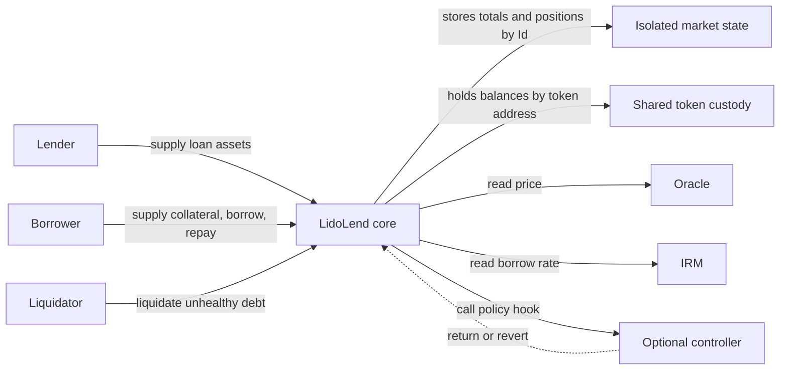

# LidoLend Specification

`LidoLend` forks [Morpho Blue at commit `1478e9cfe1b4d514f80682b3b60e4e12ff3ee45a`](https://github.com/morpho-org/morpho-blue/tree/1478e9cfe1b4d514f80682b3b60e4e12ff3ee45a). It keeps Morpho's isolated-market accounting and adds owner-gated market creation, per-market controller hooks, and a [`settle`](API_REFERENCE.md#lidolend-settle) primitive. The core is designed to run behind a proxy: the implementation locks itself in its constructor, and `initialize` sets the owner once in proxy storage.

The [`morpho-blue-whitepaper.pdf`](morpho-blue-whitepaper.pdf) explains the inherited accounting model; this specification focuses on fork-specific behavior.

## Contents

- [System model](#system-model)
- [Inherited behavior](#inherited-behavior)
- [Market creation](#market-creation)
- [Controller hooks](#controller-hooks)
- [Settlement](#settlement)
- [Proxy and storage](#proxy-and-storage)
- [Trust assumptions](#trust-assumptions)
- [Compatibility and fork delta](#compatibility-and-fork-delta)
- [References](#references)

## System model

One `LidoLend` contract stores many markets. A market is identified by `Id = keccak256(MarketParams)`, where `MarketParams` contains its loan token, collateral token, oracle, interest-rate model (`IRM`), and liquidation loan-to-value (`LLTV`). Positions and totals are isolated by `Id`, but token custody is shared by token address in the core contract. A flash loan may use the core's full balance of a token across markets.



The core contract performs accounting and token transfers. A controller may accept or reject hooked actions. The oracle prices collateral. The IRM returns the borrow rate.

## Inherited behavior

Lenders supply loan assets and receive supply shares. Borrowers supply collateral and incur borrow shares when they borrow. Share-to-asset conversions use `VIRTUAL_ASSETS = 1` and `VIRTUAL_SHARES = 1e6`. Credits and outputs generally round down; required inputs, debits, and share burns generally round up. Asset amounts are raw token units, share amounts are raw share units, and WAD-scaled fractions use `1e18` as one.

Interest accrues lazily. Most actions accrue before resolving their amounts. External `accrueInterest` may be called by anyone. `supplyCollateral` does not accrue because collateral does not affect the interest calculation. For a positive elapsed interval of `t` seconds and a non-zero IRM, the core obtains a per-second WAD rate `r` and computes a WAD growth factor with `wTaylorCompounded(r, t)`. The function uses the first three non-zero Taylor terms to approximate `e^((r / 1e18) * t) - 1`. Multiplying total borrow assets by that factor, rounded down, gives the accrued interest. The same interest amount increases total borrow assets and total supply assets. A zero-address IRM accrues no interest. If the market fee is non-zero, the core mints supply shares to `feeRecipient`.

A borrower is healthy when its upward-rounded debt is less than or equal to its downward-rounded collateral value multiplied by `LLTV`. For an unhealthy position, the liquidation incentive factor (`LIF`) depends on the market's `LLTV`. Ignoring intermediate WAD rounding:

```text
LIF = min(1.15, 1 / (1 - 0.3 * (1 - LLTV)))
```

Lowering `LLTV` increases `LIF` until the 1.15 cap is reached. Ignoring raw-unit rounding, the liquidator receives collateral worth `LIF` times the repaid debt, so exhausting collateral can repay at most `collateralValue / LIF`. Any remaining debt is removed from both total borrow assets and total supply assets and is borne by lenders. This loss can occur while the debt is still less than or equal to the full collateral value.

Authorization allows an operator to reduce another account's supply, increase its debt, or withdraw its collateral. The core does not require authorization to supply assets, repay debt, or add collateral for another account. Authorization is global to the core, not scoped by market or action. An operator authorized for `settle` can therefore also withdraw supply, borrow, or withdraw collateral for the same account in every market stored by that core.

## Market creation

A market keeps the upstream five-field `MarketParams` and the same `Id` derivation. The fork stores two additional values outside `MarketParams`:

| Value | Rule |
| --- | --- |
| `marketController[id]` | Optional. Bound at creation. |
| `isSettlementEnabled[id]` | May be enabled only by the controlled-market creation call. |

Keeping the controller outside `MarketParams` preserves the upstream market id, but it also means that one parameter set can have only one controller. Market creation is therefore restricted to the owner.

The owner has two creation paths:

- [`createMarket(params)`](API_REFERENCE.md#lidolend-function-createmarket-marketparams) creates a market without a controller and with settlement disabled.
- [`createMarket(params, controller, enableSettlement)`](API_REFERENCE.md#lidolend-function-createmarket-marketparams-address-bool) requires a non-zero controller. The controller's `marketId()` must equal the new market id.

Creation rejects an LLTV greater than or equal to 100% and an existing market. When the first market using a particular IRM or LLTV is created, the corresponding enabled mapping becomes true. A non-zero IRM receives one `borrowRate` call after the new market state is stored. The core neither stores nor validates the returned rate; only a revert from that call rejects creation.

The upstream `enableIrm` and `enableLltv` functions are removed. Their view mappings now mean “used by at least one created market,” not “approved before creation.”

A controller binding and settlement setting can change only through a core upgrade. The owner cannot change them through the normal contract interface.

## Controller hooks

A controller exposes [`marketId()`](API_REFERENCE.md#ilidolendmarketcontroller-marketid) and [`on(id, event, payload)`](API_REFERENCE.md#ilidolendmarketcontroller-on). See the complete [`HookEvent` list](API_REFERENCE.md#ilidolendmarketcontroller-hookevent) and [payload types](API_REFERENCE.md#ilidolendmarketcontroller-structs). A revert from `on` rejects the complete action. The core has no bypass when a controller blocks withdrawal, repayment, liquidation, or settlement. A successful return does not bypass the core's independent health or liquidity checks.

Every action that reaches `_hook` checks one global transient lock, including actions on markets without a controller. When a controller exists, the core sets the lock, calls `on`, and clears the lock after a successful return. A nested hooked action during `on` reverts with `hook reentrancy`, even if it targets another market. `flashLoan` and authorization functions do not use this lock because they do not dispatch hooks.

Binding does not make the controller a core owner, grant it operator authorization, or give it a token allowance. Those permissions can be granted separately.

The controller interface does not authenticate hook callers. A production controller that trusts hook payloads or changes its own state must require `msg.sender` to be the expected core contract.

While `on` is running, the hook lock blocks any nested hooked action. It does not block ERC-20 calls, `flashLoan`, or owner-only functions.

### Action timing

The hook runs before the requested action's position writes, accounting writes, callback, and token transfer. Interest accrual usually happens first and may update market totals, fee shares, and `lastUpdate`.

| Action | State visible to the hook |
| --- | --- |
| `supply`, `withdraw`, `borrow`, `repay` | Post-accrual market totals and the position before the requested action. |
| `withdrawCollateral`, `liquidate`, `settle` | Post-accrual state and resolved action amounts, before the requested action writes. |
| `supplyCollateral` | Current state without interest accrual, before the collateral increase. |
| External `accrueInterest` | Pre-accrual state. The hook runs first. |

The owner-only `setFee` path accrues with the old fee without dispatching an `AccrueInterest` hook. Fee shares minted during any accrual also dispatch no `Supply` hook. Controllers that mirror market totals must account for both cases.

`supply`, `repay`, `supplyCollateral`, and `liquidate` may call `onMorpho*` on `msg.sender` when callback data is non-empty. Their callback timing differs from a flash loan started inside a controller hook:

| Callback origin | Lock state when the callback runs | Effect if the callback starts an action that reaches `_hook` |
| --- | --- | --- |
| Callback of one of the four actions above | The hook phase is complete. If a controller is bound, `on` has returned and the lock is clear. The action's accounting writes are also complete. | The nested action runs its own controller hook, if any. |
| `flashLoan` called by a controller from inside `on` | `flashLoan` calls `onMorphoFlashLoan` on the controller before `on` returns, so the lock remains set. | The nested action reverts with `hook reentrancy`. |

The numeric order of `HookEvent` and the layouts of hook payload structs are ABI boundaries. Reordering an enum member or a struct field would cause deployed controllers to decode the wrong payload.

## Settlement

[`settle`](#settle) burns a supply owner's shares to cancel a borrower's debt. It sends the calculated collateral amount to a receiver chosen by the caller. No loan tokens move, so settlement can execute when an equivalent loan-token withdrawal cannot. The market must enable settlement at creation, and its controller may reject each call.

### Actors

`onBehalf` owns the supply shares that are burned. `msg.sender` must be `onBehalf` or an operator authorized by it. The borrower does not approve settlement, and `receiver` may be any non-zero address.

> [!NOTE]
> **Market-selection assumption.** Settlement swaps part of a supplier's loan-token claim for collateral at the oracle price. It charges no settlement fee. Market selection assumes that, while an external loan-to-collateral route such as staking or depositing is available and within its caps, it returns at least as much collateral as settlement for the same loan-token value. If that route is capped or unavailable, settlement can be more attractive. The core neither uses nor checks the route.

### Amounts and execution

The caller supplies an exact borrow-share amount, denoted by `B`. All formulas use market totals after interest accrual. `B` is in raw borrow-share units. The four outputs below use raw loan-token, supply-share, or collateral-token units.

`oraclePrice` uses a `1e36` scale adjusted for the loan and collateral token decimals. Multiplying a raw collateral-token amount by `oraclePrice` and dividing by `1e36` gives raw loan-token units.

```text
borrowAssetsCanceled = ceil(B * (totalBorrowAssets + 1) / (totalBorrowShares + 1e6))
borrowAssetsDown     = floor(B * (totalBorrowAssets + 1) / (totalBorrowShares + 1e6))
supplySharesBurned   = ceil(borrowAssetsCanceled * (totalSupplyShares + 1e6) / (totalSupplyAssets + 1))
seizedAssets         = floor(borrowAssetsDown * 1e36 / oraclePrice)
```

The core applies no liquidation incentive factor (`LIF`). Passing the borrower's full remaining borrow-share balance closes the debt position if the calculated supply burn and collateral payout pass the checks below.

The core accrues interest and calculates the amounts above. Before the controller hook, it checks the resolved amounts against `onBehalf`'s supply shares and the borrower's debt and collateral. It also requires `seizedAssets` to be non-zero. The controller receives these checked amounts in [`SettleHookData`](API_REFERENCE.md#ilidolendmarketcontroller-settlehookdata).

If the hook accepts, the core applies this state transition:

```text
position[id][onBehalf].supplyShares -= supplySharesBurned
market[id].totalSupplyShares        -= supplySharesBurned
market[id].totalSupplyAssets        -= borrowAssetsCanceled

position[id][borrower].borrowShares -= B
market[id].totalBorrowShares        -= B
market[id].totalBorrowAssets         = max(0, market[id].totalBorrowAssets - borrowAssetsCanceled)

position[id][borrower].collateral   -= seizedAssets
```

The core then transfers `seizedAssets` collateral-token units to `receiver`.

### Rounding boundaries

| Step | Effect |
| --- | --- |
| Borrow-share valuation | `borrowAssetsCanceled` rounds up, while `borrowAssetsDown` rounds down. Their difference is zero or one raw loan-token unit. The supply claim uses the higher amount. The collateral payout uses the lower amount. |
| Collateral conversion | `seizedAssets` rounds down to whole raw collateral-token units. The borrower keeps the discarded fraction, which is less than one raw collateral-token unit. Depending on the oracle price and token decimals, that fraction may be worth more than one raw loan-token unit. |
| Supply-share conversion | `supplySharesBurned` rounds up. The supply owner burns less than one raw supply share above the exact result. The extra value stays with the remaining supply shares. |

Subtracting the upward-rounded `borrowAssetsCanceled` may reduce the loan-token debt represented by other borrowers' unchanged shares.

> [!NOTE]
> **One-unit borrow-asset overshoot.** The debt check limits `B` in shares, not assets. After the virtual offsets and upward rounding, `borrowAssetsCanceled` can equal `totalBorrowAssets + 1`. The core then sets `totalBorrowAssets` to zero but subtracts the full amount from `totalSupplyAssets`, so free liquidity falls by one raw loan-token unit. A controller that projects the post-settlement totals must apply the same floor.

`totalSupplyAssets` needs no equivalent floor. If `borrowAssetsCanceled` exceeded that total, `supplySharesBurned` would exceed `onBehalf`'s balance. The call would revert before subtraction.

### Health and debt clearing

`settle` does not check borrower health. It uses the same accounting at every LTV, including LTV above 100%. A controller may add its own health or policy check.

Ignoring rounding, settlement removes the same loan-token value from debt and collateral. The difference between them does not change. For a partial cut that leaves both debt and collateral, LTV falls when it starts below 100%, stays unchanged at 100%, and rises when it starts above 100%. The actual calculation rounds debt up and collateral down, so a controller must use the resolved hook amounts.

> [!NOTE]
> **Some debt cannot be cleared through `settle`.**
>
> - **Zero collateral payout.** If settling all remaining borrow shares gives `seizedAssets == 0`, the core rejects the call before the controller hook. At the same market totals and oracle price, every smaller cut also gives zero. This case should be resolved by calling `repay` for the remaining borrow shares.
> - **Zero collateral with debt remaining.** If settlement takes all collateral before all borrow shares are canceled, the remaining shares stay as debt. A liquidator can use a helper contract to add one raw collateral-token unit for the borrower and then call `liquidate` with `seizedAssets = 1` and `repaidShares = 0` in the same transaction. If the borrower remains unhealthy and the derived `repaidShares` do not exceed its remaining borrow shares, the liquidator receives the collateral unit back and pays the calculated loan-token amount. The bad-debt branch then clears that borrower's remaining shares and writes off their asset value against suppliers, capped by the market's remaining `totalBorrowAssets`. A controlled market must accept both calls. If the remaining borrow shares represent only dust-sized debt, prefer `repay` instead.
>
> The core has no standalone write-off function.

## Proxy and storage

The core constructor sets `isInitialized = true` in the implementation's own storage. This prevents direct initialization of the implementation. A compatible fresh proxy must leave the core's storage slots zero before calling [`initialize(newOwner)`](API_REFERENCE.md#lidolend-initialize) once. Initialization rejects a zero owner and emits `SetOwner`.

[`DOMAIN_SEPARATOR()`](API_REFERENCE.md#lidolend-domain-separator) is recomputed from `block.chainid` and `address(this)` on every call. EIP-712 authorization signatures are therefore bound to the proxy address and current chain id.

Persistent storage is append-only:

| Slots | Variables | Origin |
| --- | --- | --- |
| 0–8 | `owner`, `feeRecipient`, `position`, `market`, `isIrmEnabled`, `isLltvEnabled`, `isAuthorized`, `nonce`, `idToMarketParams` | Morpho, unchanged order |
| 9 | `marketController` | Fork |
| 10 | `isSettlementEnabled` | Fork |
| 11 | `isInitialized` | Fork |

New persistent fields must be appended after slot 11 or packed into unused bytes without changing existing offsets. The hook lock is declared `transient` and uses no persistent slot. It requires an EVM with EIP-1153 support. This repository compiles the core with Solidity 0.8.36 and targets Cancun.

A proxy deployment must preserve this storage layout and initialize the core atomically.

> [!WARNING]
> `initialize(newOwner)` has no caller restriction. If proxy deployment and initialization are separate transactions, any account can initialize first and become owner.

## Trust assumptions

| Actor or dependency | Power and assumption |
| --- | --- |
| Proxy admin, if the deployment is upgradeable | Can replace core logic and therefore has full power over state and funds while upgrades remain possible. |
| Owner | Creates markets, changes the market fee up to `MAX_FEE`, changes `feeRecipient`, and transfers ownership. Changing `feeRecipient` before accrual directs pending fee shares to the new recipient. Setting the owner to zero permanently disables normal market creation and fee administration unless the proxy is upgraded. |
| Controller | Can reject every hooked action in its market. A faulty implementation can halt those actions. Binding grants no token allowance, LidoLend authorization, or core ownership. |
| Oracle | Determines collateral value for health checks, liquidation, and settlement. It must use the required scale and not revert or return values large enough to overflow core arithmetic. |
| IRM | Determines interest charged over time. It must not reenter or revert and must not return a rate large enough to overflow interest accrual. |
| Tokens | Must not reenter, rebase, burn the core's balance arbitrarily, or charge transfer fees. With sufficient balances and approvals, transfers must succeed and change balances by exactly the requested amount. |
| Callback implementer | May execute arbitrary code before the action's final incoming token transfer. It must leave sufficient balance and allowance for that transfer. |

The inherited safety model assumes an oracle price cannot fall instantaneously below its previous value multiplied by `LLTV * LIF`. A larger jump can move a position past the collateral-exhaustion loss boundary before liquidation can act. Loan assets supplied and borrowed must also remain small enough for share totals to fit in `uint128`; the [`IMorpho` dependency assumptions](src/interfaces/IMorpho.sol) place the practical bound near `1e32` raw loan-token units.

## Compatibility and fork delta

| Area | Compatibility |
| --- | --- |
| `MarketParams`, positions, market totals, and `Id` | Same shapes and derivation as upstream. |
| User action signatures and Morpho callbacks | Preserved, except for the added `settle` function. |
| Market creation | Both overloads are owner-only. `enableIrm` and `enableLltv` are removed. |
| Controller behavior | Nine market actions dispatch the bound controller and share one transient reentrancy lock. |
| Proxy behavior | The implementation constructor locks initialization; `initialize` sets the owner once in proxy storage. The domain separator is computed at call time. |
| Storage | Fork fields are appended at slots 9–11. |
| Compiler and EVM | Solidity 0.8.36, Cancun. |

## References

- [Morpho Blue source at the fork point](https://github.com/morpho-org/morpho-blue/tree/1478e9cfe1b4d514f80682b3b60e4e12ff3ee45a) and [`morpho-blue-whitepaper.pdf`](morpho-blue-whitepaper.pdf) for inherited behavior.
- [FORK_NOTES.md](FORK_NOTES.md) for the mechanical fork record.
- [TEST_PLAN.md](TEST_PLAN.md) for the requirement-to-test map.
- [API_REFERENCE.md](API_REFERENCE.md) for the generated public API, controller ABI, events, and errors.
- [`IMorpho.sol`](src/interfaces/IMorpho.sol) for inherited API and dependency assumptions.
- [`ILidoLend.sol`](src/interfaces/ILidoLend.sol) for the fork-added core surface.
- [`ILidoLendMarketController.sol`](src/interfaces/ILidoLendMarketController.sol) for the controller ABI.
